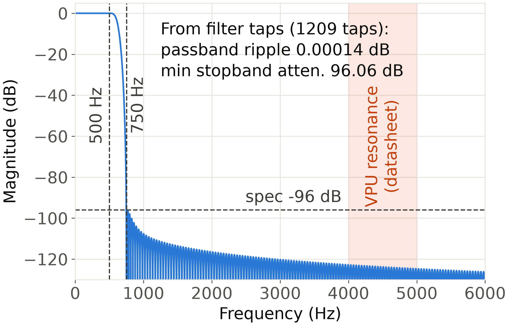
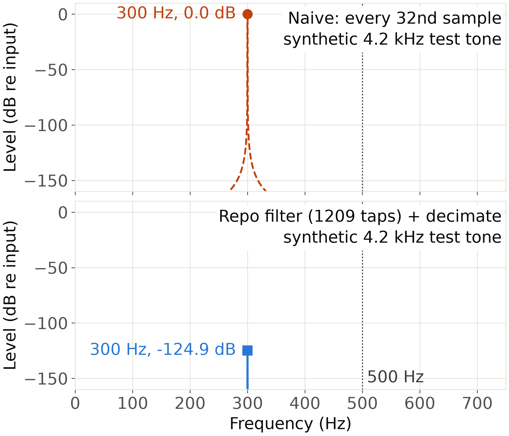

# everyday-objects-sensing

AI Design Catalog prototype (live site): https://lucaslombanaarias.github.io/everyday-objects-sensing/

## everyday_sensing (Python package): Development

These instructions are only for the `everyday_sensing` Python package in `src/everyday_sensing/`, not the rest of the repository.

Install (from the repo root, ideally in a virtual environment):

```
pip install -r requirements.txt
```

Run lint and tests:

```
ruff check .
pytest -q
```

Regenerate the decimation filter report in `results/decimation_filter/`:

```
python -m everyday_sensing.filter_report
```

Regenerate the slide figures in `docs/figures/`:

```
python scripts/plot_filter_figures.py
```

and the floor test slide figures (bare against enclosed):

```
python scripts/plot_floor_slides.py
```

## Wavelet transform (MATLAB)

`matlab/wavelet/` has the Morlet wavelet transform code from Prof. Vakakis's lab, with an example. See [its README](matlab/wavelet/README.md) for how to run it on a trial and compare two floors.

## Recording data

For floor tests (drops, stomps, steps and walking at set distances, on different floors and mounts), follow the [floor test procedure](docs/testing/floor_procedure.md).

Flash `firmware/vpu_pcm_stream` to the XIAO ESP32-C6 (see [its README](firmware/vpu_pcm_stream/README.md)), close the Arduino Serial Monitor and any dashboard, then record one trial per command from the repo root:

```
python -m acquisition.record --port COM3 --trial-id <id> --duration <s> --excitation-type ball_drop --impacts 1 --mount-method putty_wax --excitation-point P1 --distance-m <m> --drop-height-cm <cm> --tip <tip> --floor-material <material> --baseline-noise-id <noise trial> --operator <initials> --fw-commit <commit>
```

Ambient baseline with no excitation:

```
python -m acquisition.record --port COM3 --trial-id d1_noise_01 --duration 30 --noise-only --mount-method tape
```

The recorder refuses to start (before opening the port) unless the trial has:

- `--mount-method`: `tape`, `putty_wax`, `loose` or `preloaded`, on every trial.
- `--excitation-type`: `drop_stand`, `ball_drop`, `single_step`, `double_step`, `walking` or `stomp`, unless `--noise-only`.
- `--impacts`: the number of impacts made, 1 or more, unless `--noise-only` (noise-only trials record 0).

Optional: `--excitation-point` (the fixed impact point ID on this floor), `--distance-m` (the sensor radius, impact point to sensor center), `--drop-height-cm` and `--tip`, `--floor-material`, and `--baseline-noise-id` (the noise-only trial recorded as this block's baseline). Sidecars written before these fields existed still load: missing fields read as null, and old values such as excitation `footsteps` are kept as they are.

Each trial writes three files to `data/raw/<date>/` (not committed):

- `<trial-id>.csv`: `sample_index` (device counter, so lost samples show as jumps), `host_time_s` (arrival time of the sample's frame), `counts` (int16 PCM; PDM full scale is +-32768).
- `<trial-id>.json`: all metadata flags, the repo and firmware commits, and the sanity checks. `start_time` is the host time of the first sample, to the millisecond (`meta_version` 2; earlier sidecars have it to the second, taken when recording started).
- `<trial-id>.mat`: the same signal, `fs_hz`, and `meta` and `checks` structs for MATLAB.

The checks are printed after every trial: CRC errors, counter gaps and missing samples, device DMA overflows, clipped samples, and the sample rate measured against the host clock. The command exits non-zero if any of them fail. `python -m acquisition.record --help` lists all metadata flags.

The PCM dashboard (`tools/dashboard/vpu_pcm_dashboard.py`, see [its README](tools/dashboard/README.md)) does the same from a form, and analyzes each trial as soon as it is stopped.

To analyze a day of trials from the command line:

```
python -m everyday_sensing.impacts data/raw/<date>
```

### Detection criterion (det-v1)

An event is a local maximum of the RMS over a 5 ms detection window of the signal high-passed at 100 Hz (4th-order Butterworth, causal), evaluated 1000 times per second, that is at least 14 dB above the noise baseline; of peaks closer together than 0.25 s only the highest is kept. The baseline is the median detection level of the latest noise-only trial recorded at or before the trial (skipping its first 1 s), or the quietest 2 s of the trial if there is none. These values are frozen in `everyday_sensing.impacts.DETECTION` as version `det-v1`. The 50 ms levels in 100 to 500 Hz, 500 to 2000 Hz and 2 to 8 kHz are reported per event as features only and are not used for detection.

### Outputs

The analysis never writes into `data/raw/`. It writes to `data/analysis/<date>/` (not committed):

- `impacts_counts.csv`: one row per trial with impacts made, found, the difference, the number of edge events, and how many events carry each tag. Noise-only trials are included with 0 made: every event found in them is a false alarm (measured against the trial's own baseline, which is what det-v1 gives for a noise-only trial), and `false_alarms_per_min` is their rate. On the 10/14 noise trials this is 1.3 to 2.0 per minute.
- `events_<trial>.csv`, for every trial including noise-only ones: one row per event: `event`, `t_s` (seconds from the first sample; it falls 1 ms after the start of the 5 ms window at the peak), `timestamp` (start time plus `t_s`), `peak_db` (above the baseline), `flag` (`edge` if within 1.0 s of the start or end of the recording; flagged, never dropped), and `annotation` (`unreviewed` until tagged `true_impact`, `walk_in_out`, `other_noise` or `unknown`). Re-analysis keeps the tags of events at the same time.
- `<trial>.analysis.json`: the detection config and version, the baseline used, made against found, and the events.
- `impacts_trials.csv` (one row per event with its feature levels) and `impacts_summary.csv` (per excitation and distance).

Every CSV row carries `detection_version` and `detection_config`. `--baseline <trial-id>` measures every trial against one noise-only trial, and `--threshold-db` changes the threshold; such runs are labeled as modified and go to a subfolder (for example `threshold_16dB/`), so they never overwrite the det-v1 outputs or their tags.

## Decimation filter figures

Recordings are captured at 48 kHz and decimated by 32 to 1,500 Hz through a linear-phase Kaiser FIR (passband edge 500 Hz, ripple <= 0.1 dB, attenuation >= 96 dB from 750 Hz). All numbers on the figures are computed from the designed taps.

Magnitude response of the filter against the spec, with the sensor's datasheet resonance band (4 to 5 kHz) shaded:



A synthetic 4.2 kHz tone decimated naively (top) folds to 300 Hz, inside the kept band; through the filter and `decimate()` (bottom) it is suppressed:


