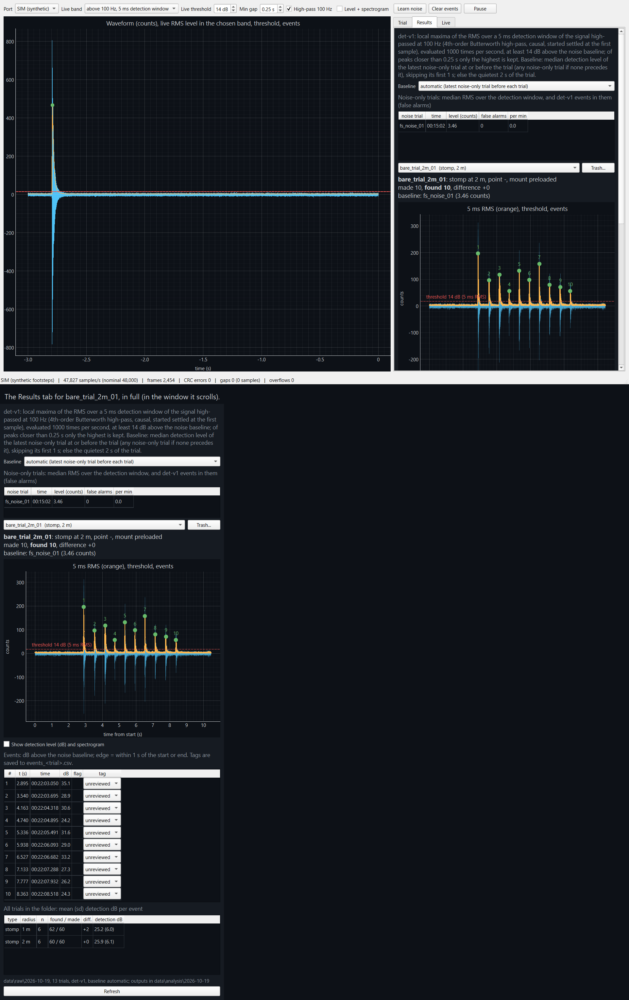

# Floor Vibration Test Procedure

How to compare what the VPU picks up bare and inside its enclosure (for example the vase base), from controlled impacts on a floor at set distances. The comparison is in the levels and spectra of the impacts. The detector's event counts are a proof of concept and a sanity check: the sponsor already has step-count data.

Firmware `vpu_pcm_stream` at 48,000 samples/s. Detector det-v1 (frozen). Revised 2026-10-19.

## 0. Fixed for every session

Write these down before the first trial and do not change them during a session. If you want to try something else (another threshold, another detector), do it afterwards on the saved recordings and label it as a new version.

| Item | Setting |
|---|---|
| Measurand | The VPU output: uncalibrated PCM counts (int16, range −32,768 to +32,767), an acceleration-type signal per the sponsor, with no conversion to m/s². Every level reported (event dB, thresholds, plots) is in dB relative to the noise baseline, not an absolute unit: 20·log10(RMS / B), where RMS is the 5 ms detection-window RMS (above 100 Hz) and B is the median of that same RMS over the latest noise-only trial recorded at or before the trial, skipping its first 1 s. If no noise-only trial precedes it, B comes from the first one in the folder; with none at all, from the quietest 2 s of the trial itself. |
| Detection criterion (det-v1) | High-pass 100 Hz (4th-order Butterworth), RMS over a 5 ms detection window evaluated 1,000 times per second, event when the RMS peaks at least **14 dB** above the noise baseline, peaks closer than **0.25 s** merged into the highest. |
| Sensor position | The sensor sits on the same tape cross S in both conditions. Switching between bare and enclosed must not move it. |
| Floor | One floor per session. Another floor is another session (or at least another block with its own baseline). |
| Impact points | One fixed point per radius (P0.5, P1, P2; P3 for extensions). Every drop at a radius lands there, in both conditions. |
| Recording window | 3 s still after Record, the excitation, 3 s still before Stop. |
| Drop stand | The same stand, ball (type and mass) and release height for every block, both conditions and both days. Enter the height and ball in Drop height and Tip, and on the session sheet. A hand release is a fallback only: write it in Notes, since it adds its own variation to the comparison. |
| Footwear | For stomps and steps: one footwear per block, written in Notes. Hard soles and socks are different conditions. |

## 1. Test plan

The main plan compares the bare sensor with the sensor in its enclosure. Both conditions get the same impacts from the drop stand at the same points, in alternating blocks within one session, so the impact, the floor and the building are the same for both. Each block starts with its own 60 s noise baseline.

### Main plan: bare against enclosed (every floor, every session)

| Block | Condition | ID prefix (tile example) | Contents | Trials |
|---|---|---|---|---|
| 1 | Bare | `tile_bare_1` | 60 s noise baseline, then 5 drops at each of P0.5, P1, P2 | 1 + 15 |
| 2 | Enclosed | `tile_vase_1` | the same | 1 + 15 |
| 3 | Bare | `tile_bare_2` | the same | 1 + 15 |
| 4 | Enclosed | `tile_vase_2` | the same | 1 + 15 |

About 64 trials, roughly 75 minutes. Short on time: 3 drops per radius per block (40 trials).

- Excitation `drop_stand`, impacts made = 1, each drop its own recording.
- Shuffle the radius order for each block and write it on the session sheet before starting (for example 2, 0.5, 1). Going near to far every time mixes distance with whatever changes over the hour.
- Switch conditions without moving the sensor's position (section 9). Then record the new block's noise baseline before its first drop.
- Repeating each condition (blocks 1 and 3, 2 and 4) shows how much a condition varies by itself over the session. A bare-against-enclosed difference only counts when it is clearly larger than that.

### What to report

For each condition and radius, over the drops of both blocks:
- the median and middle 50% of each impact's level: the detection level and the three band levels (100 to 500 Hz, 500 to 2000 Hz, 2 to 8 kHz), all in `impacts_trials.csv`;
- the enclosed-minus-bare difference in each band, in dB;
- each condition's noise floor: its noise baselines in counts (`<trial>.analysis.json`), and false alarms per minute;
- the drops found against made, as a sanity check of the detector.

The levels are relative to each block's own noise baseline. To compare received level directly, also compare the impacts' RMS in counts, which does not depend on the baseline. `python scripts/compare_conditions.py data/controlled/raw/<date>` does both for trials named `<floor>_<bare|enclosed>_<excitation>_<radius>m_<nn>`: each impact's levels in dB re 1 count, enclosed minus bare per band with whether it exceeds the trial-to-trial spread (`comparison.csv`), and the averaged impact spectra and their difference (`comparison_*.png`).

### Check before reporting

- Every noise baseline is at or below the false-alarm limit in section 8.
- No trial failed the checks in section 12, or each one that did was repeated.
- Every drop is found, or its miss or extra is explained by a tag, a near-miss marker, or a note. Misses at 2 m are a result, not a failure.

### Repeat on a second day

Run the main plan again on the same floor, with the same stand, ball and height, on a different day and at a different time of day. Compare the enclosed-minus-bare differences between the days before using either in a report. A difference between days is a systematic error to find, not noise to average away.

### Extensions (after the main plan on that floor)

| Block | Excitation | Radii | Repetitions | When |
|---|---|---|---|---|
| C | `stomp`, 10 per trial | 1, 2 m | 3 per radius, in one bare and one enclosed block | as a human-impact check of the comparison |
| A3 | `drop_stand` | 3 m | 5 per block | room allows 3 m |
| B | `drop_stand`, double | 0.5, 1, 2 m | 5 per radius | to check that two drops count as two |
| D | `single_step`, then `double_step` | 1, 2, 3 m | 3 to 5 each | before any walking |
| E | `walking`, one lap | 1, 2, 3 m | 3 laps per radius | after D is clean |
| F | `drop_stand`, other mounts (tape, putty, loose) | 1 m | 5 per mount | when comparing mounts |

## 2. Equipment

- [ ] XIAO ESP32-C6 with the VPU breakout, flashed with `firmware/vpu_pcm_stream`
- [ ] The same USB-C data cable every session, and the laptop with the repo, charged or plugged in for the whole session
- [ ] Mounting kit: the weight (weighed on a kitchen scale), a rigid flat spacer (plywood, acrylic or a hardcover book), painter's tape, putty or wax, and the enclosure being compared (for example the vase base)
- [ ] Tape measure, a string or cord to swing circles, painter's tape and a marker for the floor marks
- [ ] The drop stand and its ball (write down the ball's type and mass and the release height); a ruler to check the height
- [ ] Two identical balls for double drops
- [ ] Phone on a tripod or a stack of books for video of the feet and impact point, and a metronome app on a second phone or earbuds
- [ ] Notebook and the printed session sheet (section 14)

## 3. Before the session

### Software

1. In the repo folder, update and run the tests. All should pass (144 as of 2026-10-19). Write the commit on the session sheet.
   ```
   git pull
   python -m pytest -q
   git rev-parse --short HEAD
   ```
2. Close the Arduino IDE Serial Monitor, the Serial Plotter and any other dashboard. Only one program can hold the COM port.
3. Plug the laptop charger in now if it will be used at all. Plugging or unplugging it during a block can change the electrical noise; if that happens, record a new noise baseline.
4. Check the clock. Trials are saved in a folder named after the date, and a trial is matched to the latest noise baseline recorded before it. A session that crosses midnight starts a new folder with no baseline in it: record a new noise baseline right after midnight.

### Board health check

1. Plug in the board and find its port: `python -m serial.tools.list_ports -v`.
2. Open the Arduino Serial Monitor on that port (any baud). The board prints one `stats` line per second. Check: `pcm_per_s` about 48,000 (it alternates around it), `ovf` constant, `cpu_pct` steady near 47, `ones` about 0.500, `layout=msb`, and `rms` at rest in the tens of counts or less.
3. Keep the sensor still and send `V`. The result must say `# lowest noise: msb (current setting msb)`. If another layout wins, stop: the wiring or firmware changed. The overflow counter jumps once after `V`; that is expected.
4. Do not press Upload, whatever sketch is open in the editor. Close the Serial Monitor.

## 4. Choosing and documenting a floor

Floors differ in how far and how strongly they carry the click of an impact (above 100 Hz, which det-v1 uses) and the low thump below it. Test each floor as its own session, with the same blocks, so the results can be compared floor to floor.

| Floor | What to write down | What to expect |
|---|---|---|
| Tile on a slab | Tile size, grout, room | Strong, sharp clicks; the 10/14 footsteps at 1 to 2 m |
| Wood or laminate on joists | Board direction, whether the sensor sits over a joist | More low-frequency flex; distance along and across boards may differ |
| Carpet | Pile height, pad if known | Weak clicks; drops and stomps may fall below the threshold |
| Concrete | Bare or sealed, ground floor or not | Stiff and quiet; impacts may not travel far |

- Put the material and room in the form's **Floor** field, for example `tile, hallway`. Never leave it empty.
- Pick a spot at least 3 m from walls, fridges, fans, washers and dryers if possible. Turn off what you can; write down what you cannot (HVAC, a neighbour's laundry).
- Photograph the floor around the sensor and note the photo names on the session sheet.

## 5. Site layout

1. Mark the sensor location with a tape cross. This is point **S**.
2. For each radius, tie a cord to a pin at S at that length (0.5, 1, 2, 3 m) and swing it to place the marks below. Each mark is a foot placement, so the walker steps only on marks and the number of steps per lap is known.
3. The mark at 0° on each circle is that radius's impact point: **P0.5, P1, P2, P3**. Every drop and stomp at that radius lands on it.
4. Number the marks counterclockwise from the P mark (mark 1).
5. Seat the operator and laptop outside the largest circle, on a chair or table, never on the floor. A click on a laptop sitting on the floor is recorded as an impact.

### Mark spacing for walking circles

Marks are spaced for a normal step of about 0.7 m. Spacing much wider than that makes the walker lunge, which is a different step. The straight-line distance between neighbouring marks is 2·r·sin(180°/N).

| Radius r | Marks N | Angle between marks | Mark to mark | Use for walking |
|---|---|---|---|---|
| 0.5 m | 4 | 90° | 0.71 m | No: too tight to walk naturally. Drops, stomps and single steps only. |
| 1 m | 9 | 40° | 0.68 m | Yes |
| 2 m | 18 | 20° | 0.69 m | Yes |
| 3 m | 27 | 13.3° | 0.70 m | Yes, if the room allows |

## 6. Sensor mounting

The mount changes what the sensor hears. On 10/18 a different mount and soft footwear together removed almost all of the steps' energy above 100 Hz. Change one thing at a time, and take a new noise baseline after every mount change.

| Condition | Form: Mount | How |
|---|---|---|
| Bare sensor, weight on top (main) | `preloaded` | VPU contact side down and flat on the floor at S; spacer on the board; the weight on the spacer. Write the mass in Notes. |
| Tape only | `tape` | Board flat, taped down on two sides, no weight. |
| Putty or wax | `putty_wax` | A thin, even layer under the contact face; press once, do not twist. |
| Loose | `loose` | Board set down, nothing holding it. |
| Inside an object (vase base enclosure) | how the sensor is held inside it | Put the object in the ID prefix and Notes, for example prefix `tile_vase`, Notes `sensor inside vase base enclosure`. |

- [ ] Wipe the floor at S first: grit makes point contacts and lets the board rock.
- [ ] Check that the VPU contact face, not breadboard pins or tall parts, touches the floor.
- [ ] Push gently on each corner of the weight. If it rocks, use a flatter object or a wider spacer: a rocking weight makes its own small impacts.
- [ ] Use the smallest weight that keeps the board from shifting when you nudge the cable. There is no load rating for the VPU; never stand or press on it.
- [ ] Tape the USB cable to the floor 20 to 30 cm from the board with a loose slack loop between the tape and the board.
- [ ] Photograph the mount from above and from the side.

## 7. Dashboard and naming

```
python tools/dashboard/vpu_pcm_dashboard.py --port COM3
```

Use the port from the list. On another laptop, set up the repo's environment first and run it with that environment's Python. Watch the live waveform for 30 s with everyone still: it should be flat apart from the hum. Tap the floor about 0.3 m away and confirm a dot appears, without pressing Record.

### Trial form

| Field | What to enter |
|---|---|
| Excitation | `ball_drop`, `drop_stand`, `stomp`, `single_step`, `double_step`, `walking`, or noise only. Required. |
| Impacts made | The planned number (section 9). Required: Record refuses to start without it. |
| Excitation point | `P1` and so on. Greyed out for walking. |
| Sensor radius | Impact point (or circle) to sensor centre, in m. |
| Drop height, Tip | Drops only: height in cm, and the ball (type, mass). |
| Floor | Material and room. |
| Mount | See section 6. Required. It starts blank at launch; Record refuses until one is picked, then it stays for the following trials. |
| Baseline noise | Fills itself with the newest noise trial. Leave it. |
| Operator | Who runs the laptop. |
| Notes | What has no field: walker, footwear, mass on top, object, cadence, anything unusual. Check it before each trial: notes carry over from the previous one. When they are unchanged from the last saved trial, Record stops once and outlines Notes in orange; edit them, or press Record again to keep them. |
| ID prefix | One per block, see below. Required: it starts blank, and Record refuses until it is filled. |
| Trial ID | Fills itself in. Do not type one. |

### Naming

The trial ID is `<prefix>_<radius>m_<nn>` (0.5 m is written `0p5m`); noise trials are `<prefix>_noise_<nn>`. Use one prefix per block, `<floor>_<condition>_<block number>`, so every block's trials and its noise baseline share a name, and no two blocks do:

| Prefix | Example IDs |
|---|---|
| `tile_bare_1` | `tile_bare_1_noise_01`, `tile_bare_1_1m_03` |
| `tile_vase_1` | `tile_vase_1_noise_01`, `tile_vase_1_0p5m_02` |
| `tile_bare_2` | `tile_bare_2_2m_05` |
| `tile_vase_stomp` | `tile_vase_stomp_2m_01` (extension C) |

**Results tab:** keep the Baseline dropdown on "automatic". Choosing a noise trial there sends the outputs and your tags to a separate subfolder.

## 8. Noise baseline

Every trial is measured in dB above a noise-only recording. Record one at the start of every block (in the main plan, every bare and every enclosed block), and again after any change: mount, enclosure, sensor position, charger, or anything that starts running in the building.

1. Set the prefix for the coming block, Excitation to noise only, and the Mount as it will be for the block.
2. Everyone still and silent; phones face down and not on the floor.
3. Record a full **60 s**.
4. In the Results tab, read the noise table: **false alarms** and **per min**. These are det-v1 events in a recording where nothing happened. The rate shown is det-v1 events against the trial's own det-v1 baseline, over the whole recording; the three 10/14 noise trials give 1.3 to 2.0 per minute this way. (The 1.3 to 4.1 noted on 10/14 measured each trial against its quietest 2 s instead, over the recording after its first 1 s, so it does not compare with this limit.) Above 3 per minute, find the source before continuing; the dashboard shows the rate in orange above 3.
5. Tag each false alarm with its likely cause (`other_noise` or `unknown`) and write the cause on the sheet.

## 9. Trial blocks

### Switching between bare and enclosed

1. Stop recording. Note the time on the session sheet.
2. Take the sensor out of (or put it into) the enclosure without lifting the tape cross or moving S. If the enclosure is placed over the sensor, mark its outline on the floor the first time and put it back on that outline every time.
3. Set Mount and Notes for the new condition (for example Notes `sensor inside vase base enclosure, mass 450 g`), and the new block's prefix.
4. Check that nothing rocks: press the enclosure's edges, or the weight's corners for the bare sensor.
5. Record the block's 60 s noise baseline before its first drop.

### A. Drop stand (main plan)

- Set the stand over the radius's P point with the release height fixed (for example 50 cm, ball bottom to floor). Release from rest.
- Catch the ball after its first bounce. Every bounce is a real impact: an uncaught bounce turns 1 made into 2 or 3 found, and adds a second impact to the levels.
- The catcher kneels in the same place and posture every time and holds still until Stop. A person shifting weight 0.5 m from the sensor makes impacts too.
- Excitation `drop_stand`, impacts made = 1. Five trials per radius per block, each its own recording, in the block's shuffled radius order.
- If the stand is not available, drop by hand from the marked height and write "hand release" in Notes; keep the same release in both conditions.

### B. Double drop (extension)

- Two drops on the same point about 2 s apart, using two identical balls so the dropper does not need to re-lift one. Catch each after its first bounce. Impacts made = 2.
- This checks that one drop is not split into two events, and that two drops are counted as two. Closer pairs are not part of the procedure: one person cannot catch the first bounce and release the second ball within 0.3 s. The 0.25 s merge is detector logic, tested on synthetic impacts in `tests/test_det_v1_regression.py`.
- Five trials per radius.

### C. Stomps (extension)

- The walker stands with both feet on the P mark and stomps with the same foot, 10 times, about 1 s apart, then freezes. Impacts made = 10.
- Keep the stomp force as even as possible. At 2 m and beyond, the softest stomps are the ones that fall below the threshold.
- Three trials per radius, in one bare and one enclosed block. Write the footwear in Notes. Stomps vary in force from one to the next, so they check the comparison with a human impact but do not replace the drop stand.

### D. Single and double step (extension)

- Single step: the walker starts still with both feet on mark N (the mark next to P, clockwise), steps one foot onto P, and **freezes in that split stance** (do not bring the other foot up, which would be a second footfall). Impacts made = 1.
- Double step: start on mark N−1, step onto mark N, then onto P, and freeze in split stance. Impacts made = 2.
- Three to five trials of each per radius.

### E. Walking a circle (extension, after D)

- Set the metronome to one cadence for the whole session (for example 100 beats per minute, one step per beat, 0.6 s between steps) and write it in Notes. The cadence gives an expected time between events to check the timestamps against.
- The walker starts still with both feet on mark 1. Press Record, wait 3 s, then step mark to mark on the beat for exactly one lap counterclockwise, land on mark 1, bring the trailing foot alongside, and stand still 3 s before Stop.
- **Impacts made = N + 1**: N footfalls on the marks (including the return to mark 1) plus the closing step. With 18 marks at 2 m, that is 19. Keep this rule for every lap.
- Same shoes (or socks), same normal step, same direction every lap. Do not mix firm steps and stomps in one condition.
- Video the feet from outside the largest circle. Say the trial ID aloud at the start of each recording so the video can be matched to the trial later.
- Three laps per radius, each a separate recording, in shuffled radius order.

**Footwear is a condition.** Hard soles on tile give a sharp click above 100 Hz that det-v1 is built for. Socks and soft soles may leave only a low thump below 100 Hz, which det-v1 does not see. Run them as separate blocks with their own prefixes.

### F. Other mounts (extension)

- At 1 m with the drop stand, five trials for each other mount (tape only, putty, loose), alternating with the main bare mount as in the main plan.
- New prefix and new 60 s noise baseline after every change. Do not touch the board between trials within a mount.

## 10. Per-trial routine

1. Everyone still; the walker or dropper in the start position.
2. Check the form: excitation, impacts made, point, radius, mount, prefix, and that Notes describe this trial, not the last one (Record stops once if they are unchanged).
3. Press Record (or `R`). Wait 3 s. Any click lands in the first second, where it is flagged as an edge event.
4. Make exactly the planned excitation.
5. Hold still 3 s. Press Stop.
6. Read the result straight away (section 11): made, found, difference.
7. If the counts differ, decide now what each extra or missing event was, and tag it. Check the video for walking.
8. If something went wrong (someone moved, the ball rolled, the walker stumbled), keep the recording, write "invalid: reason" next to its ID on the session sheet, and repeat the trial. It gets the next ID automatically.

## 11. Reading the results

The Results tab opens on the trial just recorded. The header shows made, found and the difference (orange when not zero), edge events, tags, and any peaks just below the threshold.



The PCM dashboard on `tile_bare_stomp_2m_01` (saved as `bare_trial_2m_01`, the name in the screenshot; 10 stomps at 2 m, bare sensor, 18 October evening session): the full window, then the whole Results tab, which scrolls in the window. No board was attached when this was taken, so the live view on the left shows the synthetic SIM stream. The summary table at the bottom groups trials by excitation and radius only, so the bare-sensor and vase trials of that session are pooled there.

| On the plot | Meaning |
|---|---|
| Bold orange curve | The RMS over the 5 ms window. This is what the detector tests. |
| Dashed line | The 14 dB threshold, for the orange curve. The faint blue waveform behind it can cross the line without an event: on the 18 October evening session's stomp trials (122 events, recorded just after midnight), an event's waveform peak was 1.4 to 3.2 times its 5 ms RMS (median 1.65 with the bare sensor, 2.6 in the vase enclosure). |
| Green dot, numbered | A detected event. |
| Orange dot | An event within 1 s of the start or end (edge). Flagged, never dropped. |
| Hollow circle with a dB value | A peak between 10 dB and the threshold: a near miss, not an event. |
| Hollow square, "merged" | A separate burst above the threshold that det-v1 merged into a stronger event less than 0.25 s away. |

### Tags

Each event in the table under the plot has a tag. It is saved to `events_<trial>.csv` as soon as you pick it, and kept when the folder is analyzed again.

- `true_impact`: one of the planned impacts
- `walk_in_out`: stepping onto or off the start position
- `other_noise`: anything else with a known cause: the Record click, a door, a bounce
- `unknown`: cannot tell, even from the video

Never delete an event. A tagged extra is an explained extra; a missing impact is explained by its hollow marker and level.

## 12. Stop and fix

Stop the block and fix the cause if:

- Stop reports "CHECKS FAILED", or the status bar shows CRC errors, gaps or overflows climbing.
- The sample rate in the status bar stays more than 2% away from 48,000 (it normally wobbles by a few hundred).
- A noise baseline shows more than 3 false alarms per minute.
- The board or weight has moved off the tape cross, or the weight rocks.
- The background rises: events appear before anyone moves. Find what started running, then record a new baseline.
- The trial crossed midnight without a new baseline after it.

## 13. After the session

1. Check that every trial in `data/raw/<date>/` has its `.json`, `.mat` and `.csv`. The `.json` is written last, so a missing one means the save did not finish.
2. Make one plot per trial and the made-against-found summary. They go to `data/figures/<date>/`.
   ```
   python scripts/plot_trials.py data/raw/<date>
   ```
3. Finish tagging against the video; re-run the command above so the plots show the tags.
4. Fill in the session sheet completely.
5. Back up `data/raw/<date>` and `data/analysis/<date>`. They are not in git.
6. To publish controlled data: copy each trial's `.json` and `.mat` to `data/controlled/raw/<date>/` and the `events_*.csv` files to `data/controlled/analysis/<date>/`, run `python scripts/plot_trials.py data/controlled/raw/<date>`, add the date's section to `data/controlled/README.md`, then commit and push. Leave the per-sample CSVs out; the `.mat` holds the same data. Get everyone named in the notes to agree before their name goes public.

## 14. Session sheet

One per session, filled in as you go.

| Field | Entry |
|---|---|
| Date, start and end time | |
| Floor (material, room, substrate if known) | |
| Running and could not be turned off | |
| Repo commit, tests passed, `V` self-test result | |
| Mount, mass on top, spacer, object | |
| Drop stand, ball type and mass, release height, catcher | |
| Block order, prefixes and switch times | |
| Walker, footwear, cadence | |
| Shuffled radius order per block | |
| Noise baselines: ID, false alarms per minute, causes | |
| Invalid trials: ID and reason | |
| Photo and video file names | |
| Check before reporting passed (Y/N, and what failed) | |
| Day 1 or day 2 of this floor | |
| Anomalies | |

## 15. Why these rules

Each rule above traces to something that happened in the first sessions.

- **10/14:** firm steps and stomps mixed in one condition made the 2 m results unreadable. One step style per block.
- **10/15:** Vakakis asked for a few reliable measurements over many, repeated on different days. One main plan, a second-day repeat, extensions after it.
- **10/18:** socks or soft soles plus a different mount left the steps 35 to 40 dB weaker above 100 Hz than on 10/14, so det-v1 saw almost none. Change one thing at a time; footwear is its own condition.
- **10/18:** a trial recorded before its noise baseline was measured against itself, and a 10 s baseline missed a source that started later. Baseline first, 60 s, renewed after changes.
- **10/18 evening:** the operator's click on Record was counted as an impact. Wait 3 s after Record; keep the laptop off the floor.
- **10/18 evening:** notes carried over from the previous trial ("2 m" on 1 m trials) and the default prefix named stomps as footsteps. Check Notes (Record now stops once on unchanged Notes) and set the prefix per condition (it now starts blank and is required).
- **10/18 evening:** a stomp whose waveform crossed the line was missed at 13.1 dB on the RMS. The threshold is on the RMS; the plot now shows near misses.
- **10/18 evening:** the bare and enclosed trials were run back to back with hand stomps, about every 0.85 s for bare and every 0.6 s enclosed, and no noise baseline was recorded with the enclosure. The enclosed sensor read about 7 to 10 dB lower, but the excitation and the time of each condition differed, so the difference could not be put on the enclosure. Drop stand, alternating blocks, a baseline per block.
- **10/19:** the sponsor already has step-count data. The question for this project is what the enclosure does to the signal, so the comparison is the main plan and the counts are a proof of concept.
- **10/18 evening:** the session crossed midnight, so its later trials went to a new date folder. Record a new baseline after midnight.

Detection settings and the tools referenced here: `everyday_sensing.impacts` (det-v1), `tools/dashboard/vpu_pcm_dashboard.py`, `scripts/plot_trials.py`, and `data/controlled/` for published trials.
