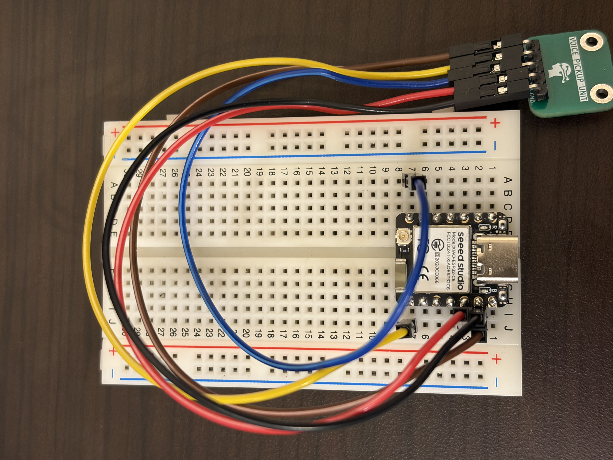

# VPU lab demo firmware

Arduino sketches for reading the Voice Pickup Unit (VPU) vibration sensor from a Seeed XIAO ESP32-C6. The sketches are kept as received from the lab; each `.ino` sits in a folder of the same name, as the Arduino IDE requires. `VPU_HighRate_View`, `VPU_WiFi_Buffered_TCP`, `receiver.py` and the wiring photo come from https://github.com/atharvj/VPU-ESP32-Demo.



## Hardware

| | |
|---|---|
| Board | Seeed XIAO ESP32-C6 (ESP32 Arduino core 3.x) |
| VPU clock | D6, 768 kHz LEDC output (`ledcAttach(D6, 768000, 2)`) |
| VPU data | D7, `INPUT_PULLDOWN` |
| USB serial | 115200 baud; set Tools > USB CDC On Boot > Enabled or nothing appears on USB |

Keep the sensor still for the ~3 s calibration after reset or power-up.

## Output

The output is a thresholded activity score from 0 to 100, not a waveform. Each score comes from 5,000 reads of the data pin: the change in duty cycle between consecutive reads, minus a noise threshold learned at startup, is log-scaled to 0 to 100, and scores below 2 are forced to 0.

The two USB sketches print about 200 lines/s at 115200 baud:

```
vibration:<float>\tfloor:0\tceiling:100
```

`floor` and `ceiling` are constants so the Arduino Serial Plotter keeps a fixed 0 to 100 scale.

## Sketches

| Sketch | Transport | Notes |
|---|---|---|
| `VPU_Chair_Serial` | USB serial, ~200 lines/s | Reports the peak score since the previous line, so short impacts are not skipped. Status lines start with `#`. Intended for `tools/dashboard/vpu_chair_dashboard.py`. |
| `VPU_HighRate_View` | USB serial, up to ~200 lines/s | Reports the latest score only (no peak hold) and no `#` status lines. Line rate is limited by how long each 5,000-read measurement takes. |
| `VPU_WiFi_Buffered_TCP` | Wi-Fi TCP to port 5005 | 100 samples/s with ESP32 timestamps, sent in `BATCH,<n>,50` ... `END` blocks to a hard-coded receiver IP. Fill in `WIFI_SSID`, `WIFI_PASSWORD` and `MAC_IP` locally before flashing; do not commit real credentials. USB serial prints batch diagnostics only. Receive with `receiver.py` (below). |

`receiver.py` is the host side of `VPU_WiFi_Buffered_TCP`: it listens on TCP port 5005, warns about missed batches, and writes every sample to `data/vpu_tcp_<timestamp>.csv` relative to the current directory (ignored by git). Stop it with Ctrl+C.

```
python firmware/vpu_lab_demo/receiver.py
```
