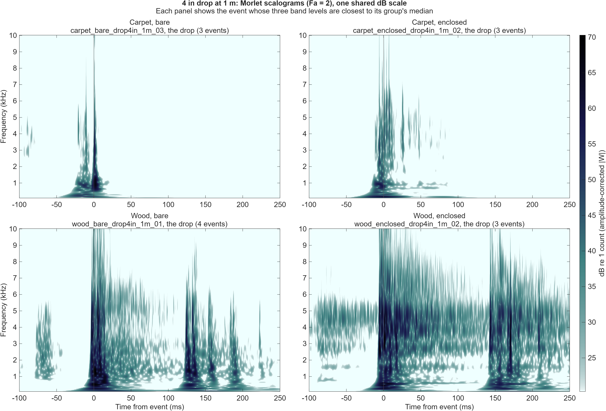
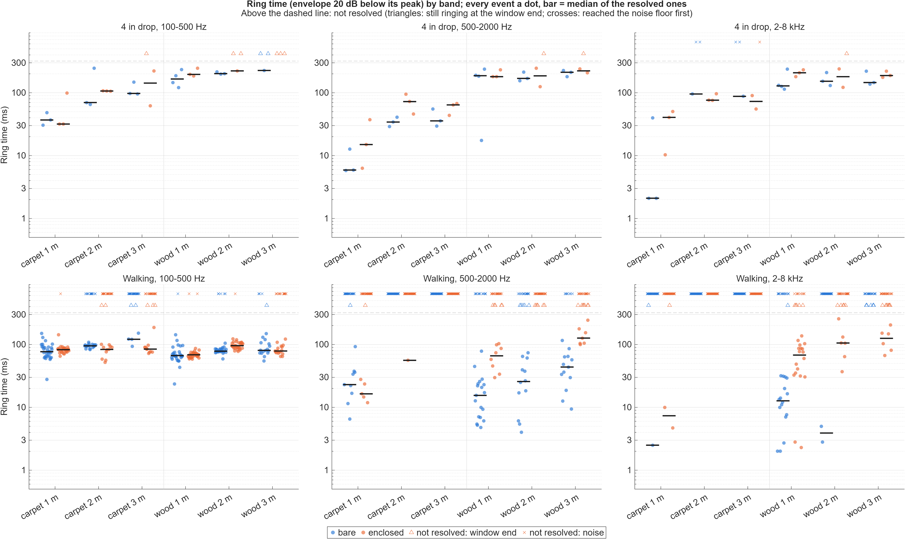

# Morlet wavelet transform (MATLAB)

Wavelet transform code from Luis M. Baldelomar Pinto (Prof. Vakakis's lab, LNDVL), sent to the team on 2026-10-27. `Example.m`, `plotwt.m` and `freq_inst_morlet.m` are as received; the other files are ours. Everything here was run in MATLAB R2025a on 2026-10-28.

| File | What it does |
|---|---|
| `freq_inst_morlet.m` | The transform. Takes the FFT of the signal, multiplies it by a Gaussian (the Morlet wavelet in the frequency domain) centered on each analysis frequency, and inverse-FFTs back to time. Returns the magnitude `|W|` as an N x `nf` matrix, and the complex transform if asked for a fourth output. |
| `plotwt.m` | Pads the ends of the signal by mirroring it (to reduce edge artifacts), runs the transform, crops back to the original samples, and plots the scalogram normalized to its own maximum. |
| `Example.m` | Two demos: a sum of sines at 20, 40 and 85 Hz, and a shock (a 1 ms half-sine pulse). |
| `compare_floors_wavelet.m` | Runs the transform on single steps from several of our trials and plots them on one shared dB scale, with a table of peak levels. Use this one to compare floors. |
| `wavelet_conditions.m` | The carpet against wood, bare against enclosed comparison of all the 2026-10-21 drops and steps: band levels, ring times and ringing frequencies per event and per group, written to CSVs, with figures. See [below](#carpet-against-wood-bare-against-enclosed). |
| `wavelet_window.m`, `wavelet_band_metrics.m`, `wavelet_params.m` | Used by `wavelet_conditions.m`: the transform of one window, the metrics of one window, and every parameter in one place. |
| `test_wavelet_metrics.m` | Checks the metrics on synthetic signals and against `comparison.csv`. |

## Comparing floors

From the repo root:

```matlab
addpath('matlab/wavelet')
compare_floors_wavelet()     % events 2 to 4 of carpet_bare_walk_1m_01 against wood_bare_walk_1m_01
compare_floors_wavelet(["carpet_bare_walk_2m_01" "wood_bare_walk_2m_01"], 1:5)
R = compare_floors_wavelet(SaveAs="steps.png");   % also save the figure and keep the table
```

Each row of the figure is a trial and each column an event. Events are det-v1 event numbers from `data/controlled/analysis/<date>/events_<trial>.csv`; some events are not steps (`walking_steps_review.csv` lists them), so check the event times before choosing. Options: `Date`, `Pre` and `Post` (window in s around the event, default 0.10 and 0.25), `Pad`, `Fmin`, `Fmax`, `Nf`, `Fa` (default 50 Hz, 10 kHz, 300, 2), `RangeDb` (default 40) and `SaveAs`. `help compare_floors_wavelet` has the details.

The table gives, per event, the strongest point (`peak_db`, `peak_ms`, `peak_hz`) and the strongest point at or above 1 kHz (`peak_above_1khz_*`). Levels are dB relative to the strongest point in any panel, and times are ms from the event time.

Why it does not just call `plotwt` on each step:

- **Shared scale.** `plotwt` divides each plot by its own maximum, so colors in two plots cannot be compared. This divides every panel by one shared maximum.
- **dB, not linear.** Most steps have their strongest point below about 120 Hz (5 of the 6 in the default run). On a linear scale that peak sets the maximum and the content above 1 kHz comes out nearly white.
- **Amplitude correction.** `|W|` for a steady sine of amplitude `A` at `f` is `A*sqrt(Fa/(2*f))`, so low frequencies read stronger than they are (in `Example.m` the 85 Hz sine has twice the amplitude of the 20 Hz one, but its band peaks at about the same level). This divides by `sqrt(Fa/(2*f))` so a sine of amplitude `A` reads `A` at every frequency.
- **Window starts early.** det-v1 marks a step after it starts: in the default run the burst starts 10 to 50 ms before the event time. So the window starts 100 ms before it.
- **Real padding.** It transforms 100 ms of real signal on each side of the window and then crops it, instead of mirroring.
- **Memory.** Our recordings are 48 kHz, so it works on one step at a time. A whole 10 s walking trial at 500 frequencies needs about 2 GB for the result alone.

Default run (bare sensor, 1 m, 2026-10-21):

| Event | Carpet: peak above 1 kHz (dB) | Wood: peak above 1 kHz (dB) |
|---|---|---|
| 2 | -28.8 | -17.5 |
| 3 | -35.5 | -8.5 |
| 4 | -22.4 | -21.7 |

On carpet the content above 1 kHz is over within about 40 ms of the event time. On wood it is stronger in events 2 and 3, reaches higher (up to about 10 kHz in event 2), and has later bursts 60 to 100 ms after the event time. Event 4's peak above 1 kHz is about the same on both floors, and carpet event 3 is weak at all frequencies, so the difference varies a lot from step to step: compare more steps and trials before drawing a conclusion.

## Using the lab's functions directly

```matlab
plotwt(t, x, F0, Ff, Fn, Fa, miri, mirf, chp1, chp2, Label)
```

| Argument | Meaning |
|---|---|
| `t`, `x` | Time (s) and signal, uniformly sampled |
| `F0`, `Ff` | Lowest and highest frequency to analyze (Hz). `F0` must be above 0 |
| `Fn` | Number of frequencies, spaced linearly from `F0` to `Ff` |
| `Fa` | Morlet center frequency: about how many cycles the wavelet spans. 2 to 6 is typical |
| `miri`, `mirf` | Padding at the start and end: `'o'` odd mirror (flipped about the end sample, keeps value and slope continuous), `'e'` even mirror (plain reflection), `''` none |
| `chp1`, `chp2` | Fraction of the signal length used for the start and end padding |
| `Label` | `'IMF'` squares the plotted magnitude (energy). Anything else plots the magnitude |

`Fa` sets the time-frequency trade-off. At frequency `f` the wavelet's time spread is about `Fa/f` seconds and its bandwidth about `f/(2*pi*Fa)` Hz, so a smaller `Fa` (the shock demo uses 2) localizes impacts better in time, and a larger one separates nearby frequencies better. A shock shows as a vertical stripe that smears out in time toward low frequencies.

For a signal that starts right at an impact (as in the shock demo), use no padding at the start: mirroring would copy the impact into negative time.

A quick look at one step with `plotwt` (linear scale, normalized to its own maximum):

```matlab
addpath('matlab/wavelet')
trial = 'wood_bare_walk_1m_01';
m  = load(fullfile('data/controlled/raw/2026-10-21', [trial '.mat']));
ev = readtable(fullfile('data/controlled/analysis/2026-10-21', ['events_' trial '.csv']));
fs = m.fs_hz;  x = double(m.counts(:));  t = (0:numel(x)-1)'/fs;

ts = ev.t_s(2);                          % second detected step
k  = t >= ts - 0.10 & t <= ts + 0.25;    % 100 ms before to 250 ms after
figure
plotwt(t(k), x(k), 50, 10000, 300, 2, 'e', 'e', 0.2, 0.2, 'sig')
```

`Example.m` draws its signals in black (`'k-'`), so they do not show on MATLAB's dark theme; switch MATLAB to the light theme to see them.

## Carpet against wood, bare against enclosed

On 2026-10-21 the enclosure raised the signal on carpet and lowered it on wood. `wavelet_conditions.m` asks whether that is an enclosure resonance (a band that keeps ringing after the impact, in the enclosed recordings only) or a floor effect (the carpet acting as a spring under the base, so longer and lower ringing on carpet in both conditions).

### Summary

Every number here is in `wavelet_summary.csv`; "Results" and "Caveats" below have the detail.

- **Drops on wood:** with the enclosure, the 2-8 kHz ringing moves to about 4 to 5 kHz (medians 4669, 3908 and 4537 Hz at 1, 2 and 3 m, against 2369, 2020 and 2020 Hz bare). Enclosed minus bare, 2-8 kHz goes up 4.7, 12.2 and 13.8 dB and 500-2000 Hz goes down 7.1, 6.1 and 6.7 dB.
- **Steps on wood show the same, without the drop stand's bounces:** enclosed steps ring at 1590, 1607 and 1590 Hz in 500-2000 Hz and at 4437, 3808 and 4669 Hz in 2-8 kHz; bare steps at 1325, 1474 and 1391 Hz and at 2418, 2550 and 2583 Hz (bare 2-8 kHz at 2 and 3 m from the 1 and 6 steps that resolve). At 1 m every enclosed trial rings longer than every bare one: 35 to 86 ms against 12 to 17 ms in 2-8 kHz (per-trial medians).
- **Carpet has no ringing band that only the enclosed recordings show:** both conditions ring at 530 to 994 Hz in 500-2000 Hz (per-trial medians), and the enclosure does not move the 2-8 kHz ringing of the drops (3378, 2683 and 3345 Hz enclosed against 3113, 3047 and 3080 Hz bare). Drop levels change in both directions depending on band and radius.
- **Most of the carpet increase above 500 Hz is noise floor:** carpet steps at 2 and 3 m are only 1.1 to 2.7 dB above noise there, and the enclosed noise floor is 2.2 to 3.0 dB higher than the bare one, about the size of the +2.4 to +4.6 dB enclosed minus bare. The clear carpet increase is 100-500 Hz at 1 m: +5.5 dB for drops and +5.3 dB for steps.
- **Verdict:** on wood the data strongly support an enclosure resonance: it is in the enclosed recordings only, at every radius, in drops and steps. The carpet-as-spring explanation is only half supported: carpet rings lower in both conditions, but not longer above 500 Hz (steps at 1 m, 500-2000 Hz: 16.4 ms on enclosed carpet against 66.1 ms on enclosed wood).
- **Inconclusive:** 4 to 5 kHz is also the sensor's datasheet resonance band, so this cannot tell an enclosure mode from the sensor's own resonance driven harder through the enclosure; a tap test on the enclosure alone would.
- **Inconclusive:** a spring mode of the enclosure on carpet would likely sit below 100 Hz, which this analysis does not see (the 100-500 Hz ringing frequency is at the 100 Hz limit in 15 of 24 groups). Carpet steps do ring a bit longer in that band (at 1 m: 76.9 against 66.6 ms bare, 82.7 against 68.6 ms enclosed), but that can also be the softer foot contact.
- **Inconclusive:** ring times on wood drops measure the stand's bounces, not the ringing (wood bare 1 m, 2-8 kHz: 128.7 ms ring time, but 9.0 ms until the envelope first falls 20 dB). The wood enclosed ringing also outlasts the 250 ms window, and there are only 3 trials per drop group (4 for wood bare at 1 m).

### Running it

From the repo root:

```matlab
addpath('matlab/wavelet')
wavelet_conditions()      % about 4 minutes; writes the CSVs and figures listed below
test_wavelet_metrics()    % the checks in "Validation"
```

Outputs:

- `data/controlled/analysis/2026-10-21/wavelet_events.csv`: one row per event (387), with the parameters on every row.
- `data/controlled/analysis/2026-10-21/wavelet_summary.csv`: one row per excitation, floor, condition and radius (24): number of events, median, min and max, and each trial's median (in trial order; `nr` when none of its events resolved), and on the enclosed rows the enclosed minus bare difference of the medians.
- `data/controlled/figures/2026-10-21/wavelet_drop4in_1m.png`, `wavelet_drop4in_2m.png`, `wavelet_walk_1m.png`, `wavelet_walk_2m.png`: scalograms, rows carpet and wood, columns bare and enclosed, one shared dB scale per figure. Each panel is the event whose three band levels are closest to its group's median (Euclidean distance in dB).
- `data/controlled/figures/2026-10-21/wavelet_ring_times.png`: the ring time of every event, by band, floor, condition and radius.

### Method

Events:

- **Drops first**, the controlled excitation (same mass, height, flat tip and impact point): the 37 `drop4in` trials. `drop7in` (carpet, bare, 1 m only) is left out. Each trial was one drop (`impacts_made` is 1 in all 37), but det-v1 found 1 to 4 events per trial (13 trials with 1, 16 with 2, 7 with 3, 1 with 4). **Rule: the drop is the det-v1 event with the highest `peak_db`.** Checked by eye on the waveform around every event of all 37 trials: every other event is at least 12.3 dB weaker (the closest is in `wood_enclosed_drop4in_1m_02`); the 8 events before a drop are 0.25 to 1.44 s earlier, at most 25.4 dB, and noise-like with no impulsive start (handling); the 25 after a drop are 0.25 to 0.58 s later and are bounces, a smaller impulse with its own ringing. It is also the impact `scripts/compare_conditions.py` uses.
- **Then steps**: rebuilt as `walking_trials()` in `scripts/plot_floor_slide_figures.py` does (the det-v1 events in `events_<trial>.csv`, less those within 0.05 s of a time in the review's `not_steps_at`, plus its `missed_at`, from `walking_steps_review.csv`). 350 steps in 35 trials (21 of them from `missed_at`), every count equal to `steps_in_signal`; `wood_bare_walk_3m_01` is left out (the review could not decide). The MATLAB list matches the Python one step for step.
- Groups are floor x condition x radius (1, 2, 3 m), separately for drops and steps. Radii and excitations are never pooled.

Transform and window:

- `freq_inst_morlet` unchanged, 100 Hz to 10 kHz in 300 linearly spaced frequencies (33.1 Hz apart), Fa = 2. 100 Hz because the VPU's specified band starts there and det-v1 high-passes there too.
- Window: 100 ms before the event time to 250 ms after, transformed with 100 ms of real signal on each side and then cropped, one window at a time. If the next det-v1 event or missed step falls inside the window, the window ends 10 ms before it: this happened once (`carpet_enclosed_walk_2m_03` step 7, 189 ms instead of 350 ms).
- **Normalization, one throughout:** amplitude-corrected magnitude, `|W| / sqrt(Fa/(2f))`, as in `compare_floors_wavelet.m`, so a steady sine of amplitude A counts reads A at its frequency. For a broadband impact this weights each frequency by about f, so **levels compare only within a band**, never between bands.
- Band envelope: at each sample, the RMS of the corrected magnitude over the band's frequencies (100-500 Hz, 500-2000 Hz, 2-8 kHz; lower edge included).

Per event and band (`wavelet_band_metrics.m`):

- **Level**: 10 log10 of the band envelope's energy over the window, in dB re 1 count² s.
- **Ring time**: from the envelope's peak until it stays 20 dB below that peak. Not resolved, never a number, if the envelope reaches the noise floor first (or the peak is less than 20 dB above it), or is still within 20 dB of the peak when the window ends.
- **Ringing frequency**: the frequency with the most energy from 20 to 100 ms after the band peak (at least 40 ms of that inside the window), kept only if that energy is at least 10 dB above the noise floor at that frequency.
- **Overall peak**: time, frequency and level of the largest corrected value at any frequency.
- Also written, as a diagnostic: `ring_first_ms`, when the envelope first falls 20 dB below the peak whether or not it stays there. It differs from the ring time when something re-excites the band, such as a bounce.

Noise floors: the same transform on windows of the same length from the noise recording of each trial's own floor and condition, after its first 1 s (35 windows of `carpet_bare_noise_01`, 40 of `carpet_enclosed_noise_01`, 38 of `wood_bare_noise_01`, 22 of `wood_enclosed_noise_01`). The floor is the median band envelope (for the ring time) and the median squared magnitude at each frequency (for the ringing frequency). In dB re 1 count, 100-500 Hz / 500-2000 Hz / 2-8 kHz: carpet bare -7.9 / -9.4 / -7.6, carpet enclosed -5.6 / -6.4 / -5.4, wood bare -8.1 / -3.8 / -6.6, wood enclosed -6.5 / -6.9 / -4.3.

27 trials name another condition's noise recording in their sidecar's `baseline_noise_id`. This analysis uses each trial's own condition instead:

| Trials | `baseline_noise_id` in the sidecar | Used here |
|---|---|---|
| `carpet_enclosed_drop4in_1m_01` to `_3m_03` (9) | `carpet_bare_noise_01` | `carpet_enclosed_noise_01` |
| `wood_enclosed_drop4in_1m_01` to `_3m_03` (9) | `wood_bare_noise_01` | `wood_enclosed_noise_01` |
| `wood_enclosed_walk_1m_01` to `_3m_03` (9) | `wood_bare_noise_01` | `wood_enclosed_noise_01` |

### Validation

`test_wavelet_metrics()` output (2026-10-28):

```
1. 1 kHz sine, amplitude 100: reads 99.71 to 99.71 (median 99.71) at 994 Hz, largest error 0.29%: PASS
2. 4.5 kHz sine, 20 dB decay in 10 ms: ring time 10.17 ms (resolved), ringing frequency 4504 Hz: PASS
2. 4.5 kHz sine, 20 dB decay in 40 ms: ring time 40.10 ms (resolved), ringing frequency 4504 Hz: PASS
   Impulse, 100-500 Hz: ring time 18.23 ms (not checked: the resolution limit)
   Impulse, 500-2000 Hz: ring time 4.15 ms (not checked: the resolution limit)
   Impulse, 2-8 kHz: ring time 1.06 ms (not checked: the resolution limit)
3. drop4in carpet 1 m 100-500 Hz  comparison.csv  +6.6 dB (separated: yes), wavelet  +5.5 dB: same sign
3. drop4in carpet 1 m 500-2000 Hz comparison.csv  -7.7 dB (separated: no ), wavelet  -8.1 dB: same sign
3. drop4in carpet 1 m 2-8 kHz     comparison.csv  -3.5 dB (separated: no ), wavelet  -2.5 dB: same sign
3. drop4in carpet 2 m 100-500 Hz  comparison.csv  +3.8 dB (separated: yes), wavelet  +3.0 dB: same sign
3. drop4in carpet 2 m 500-2000 Hz comparison.csv  +0.7 dB (separated: no ), wavelet  +1.4 dB: same sign
3. drop4in carpet 2 m 2-8 kHz     comparison.csv +11.9 dB (separated: yes), wavelet +12.8 dB: same sign
3. drop4in carpet 3 m 100-500 Hz  comparison.csv  +1.2 dB (separated: no ), wavelet  -0.6 dB: DIFFERENT SIGN
3. drop4in carpet 3 m 500-2000 Hz comparison.csv  -3.5 dB (separated: no ), wavelet  -2.9 dB: same sign
3. drop4in carpet 3 m 2-8 kHz     comparison.csv  +7.3 dB (separated: yes), wavelet  +6.5 dB: same sign
3. drop4in wood   1 m 100-500 Hz  comparison.csv  -1.9 dB (separated: no ), wavelet  -1.5 dB: same sign
3. drop4in wood   1 m 500-2000 Hz comparison.csv  -6.4 dB (separated: yes), wavelet  -7.1 dB: same sign
3. drop4in wood   1 m 2-8 kHz     comparison.csv  +4.0 dB (separated: no ), wavelet  +4.7 dB: same sign
3. drop4in wood   2 m 100-500 Hz  comparison.csv  +0.5 dB (separated: no ), wavelet  -0.7 dB: DIFFERENT SIGN
3. drop4in wood   2 m 500-2000 Hz comparison.csv  -4.8 dB (separated: no ), wavelet  -6.1 dB: same sign
3. drop4in wood   2 m 2-8 kHz     comparison.csv +10.4 dB (separated: yes), wavelet +12.2 dB: same sign
3. drop4in wood   3 m 100-500 Hz  comparison.csv  -6.8 dB (separated: yes), wavelet  -5.5 dB: same sign
3. drop4in wood   3 m 500-2000 Hz comparison.csv  -8.0 dB (separated: yes), wavelet  -6.7 dB: same sign
3. drop4in wood   3 m 2-8 kHz     comparison.csv +10.4 dB (separated: yes), wavelet +13.8 dB: same sign
3. drop4in: 16 of 18 bands have the same sign
3. walk    carpet 1 m 100-500 Hz  comparison.csv  +2.3 dB (separated: yes), wavelet  +5.3 dB: same sign
3. walk    carpet 1 m 500-2000 Hz comparison.csv  +2.3 dB (separated: no ), wavelet  +4.2 dB: same sign
3. walk    carpet 1 m 2-8 kHz     comparison.csv  +4.1 dB (separated: yes), wavelet  +2.7 dB: same sign
3. walk    carpet 2 m 100-500 Hz  comparison.csv  -1.1 dB (separated: yes), wavelet  -1.6 dB: same sign
3. walk    carpet 2 m 500-2000 Hz comparison.csv  +3.6 dB (separated: yes), wavelet  +4.6 dB: same sign
3. walk    carpet 2 m 2-8 kHz     comparison.csv  +3.8 dB (separated: yes), wavelet  +3.1 dB: same sign
3. walk    carpet 3 m 100-500 Hz  comparison.csv  +7.0 dB (separated: yes), wavelet  +3.5 dB: same sign
3. walk    carpet 3 m 500-2000 Hz comparison.csv  +3.2 dB (separated: yes), wavelet  +3.4 dB: same sign
3. walk    carpet 3 m 2-8 kHz     comparison.csv  +2.4 dB (separated: yes), wavelet  +2.4 dB: same sign
3. walk    wood   1 m 100-500 Hz  comparison.csv  -2.1 dB (separated: yes), wavelet  -0.3 dB: same sign
3. walk    wood   1 m 500-2000 Hz comparison.csv  -9.5 dB (separated: yes), wavelet -10.7 dB: same sign
3. walk    wood   1 m 2-8 kHz     comparison.csv  +5.6 dB (separated: yes), wavelet  +6.3 dB: same sign
3. walk    wood   2 m 100-500 Hz  comparison.csv  +1.8 dB (separated: yes), wavelet  +0.1 dB: same sign
3. walk    wood   2 m 500-2000 Hz comparison.csv  -6.4 dB (separated: yes), wavelet  -4.2 dB: same sign
3. walk    wood   2 m 2-8 kHz     comparison.csv +13.2 dB (separated: yes), wavelet +12.9 dB: same sign
3. walk    wood   3 m 100-500 Hz  comparison.csv  +2.4 dB (separated: no ), wavelet  +1.7 dB: same sign
3. walk    wood   3 m 500-2000 Hz comparison.csv -11.6 dB (separated: yes), wavelet  -9.9 dB: same sign
3. walk    wood   3 m 2-8 kHz     comparison.csv  +7.7 dB (separated: yes), wavelet +10.5 dB: same sign
3. walk: 18 of 18 bands have the same sign (walking: printed, not checked)
Error using test_wavelet_metrics (line 108)
At least one check failed (see above).
```

Checks 1 and 2 pass. Check 3 fails in 2 of the 18 drop bands, and both are differences neither method can resolve:

- **Carpet, 3 m, 100-500 Hz** (comparison.csv +1.2 dB, wavelet -0.6 dB). comparison.csv marks it not separated: its bare trial medians are 38.8, 40.0 and 40.8 dB and its enclosed ones 40.2, 41.2 and 41.3 dB. The wavelet trial medians overlap the same way (bare 19.7, 18.7, 20.3; enclosed 19.1, 19.1, 17.8).
- **Wood, 2 m, 100-500 Hz** (+0.5 dB against -0.7 dB). Not separated either: comparison.csv bare 47.5, 48.1, 55.2 and enclosed 47.5, 48.6, 48.8; wavelet bare 29.7, 34.3, 30.5 and enclosed 29.8, 29.5, 29.9.

In both, the difference is under 1.3 dB and smaller than the spread between trials, so its sign is not established by either measure. The two also measure different things: comparison.csv takes a 50 ms RMS through a band filter around the detection peak, and this takes the energy of the corrected wavelet magnitude over 350 ms, which at 100 Hz is smoothed over about 20 ms by the wavelet itself. Every drop band that comparison.csv marks as separated (9 of 18) has the same sign here, and so do all 18 walking bands.

The impulse lines are the shortest ring time the transform can show in each band: 18.2 ms in 100-500 Hz, 4.2 ms in 500-2000 Hz and 1.1 ms in 2-8 kHz. Ring times near these are the wavelet, not the floor.

### Results

From `wavelet_summary.csv`. Level: median, dB re 1 count² s, with enclosed minus bare in brackets on the enclosed rows. Ring: median ring time in ms over the events that resolved (resolved / events). Ringing: median ringing frequency in Hz (events with one). `nr`: none resolved.

4 in drops:

| Floor | r | Condition | n | 100-500 Hz level | ring (ms) | ringing (Hz) | 500-2000 Hz level | ring (ms) | ringing (Hz) | 2-8 kHz level | ring (ms) | ringing (Hz) |
|---|---|---|---|---|---|---|---|---|---|---|---|---|
| carpet | 1 m | bare | 3 | 30.4 | 36.9 (3/3) | 100 (3) | 37.8 | 5.9 (3/3) | 795 (3) | 23.1 | 2.1 (3/3) | 3113 (3) |
| carpet | 1 m | enclosed | 3 | 35.9 (+5.5) | 31.8 (3/3) | 166 (3) | 29.7 (-8.1) | 15 (3/3) | 696 (3) | 20.6 (-2.5) | 40.6 (3/3) | 3378 (3) |
| carpet | 2 m | bare | 3 | 23.5 | 69.9 (3/3) | 100 (3) | 15.6 | 34.2 (3/3) | 795 (3) | -3 | 95.6 (1/3) | 3047 (3) |
| carpet | 2 m | enclosed | 3 | 26.5 (+3.0) | 106.7 (3/3) | 133 (3) | 17 (+1.4) | 72.4 (3/3) | 994 (3) | 9.8 (+12.8) | 76.2 (3/3) | 2683 (3) |
| carpet | 3 m | bare | 3 | 19.7 | 97.6 (3/3) | 100 (3) | 17.6 | 35.7 (3/3) | 928 (3) | -1.6 | 87.7 (1/3) | 3080 (3) |
| carpet | 3 m | enclosed | 3 | 19.1 (-0.6) | 142.6 (2/3) | 100 (3) | 14.7 (-2.9) | 64.1 (3/3) | 961 (3) | 4.9 (+6.5) | 72.9 (2/3) | 3345 (3) |
| wood | 1 m | bare | 4 | 44.4 | 165.6 (4/4) | 117 (4) | 46.9 | 186.8 (4/4) | 1342 (4) | 37.6 | 128.7 (4/4) | 2369 (4) |
| wood | 1 m | enclosed | 3 | 42.9 (-1.5) | 196.2 (3/3) | 199 (3) | 39.8 (-7.1) | 180.4 (3/3) | 564 (3) | 42.3 (+4.7) | 208.1 (3/3) | 4669 (3) |
| wood | 2 m | bare | 3 | 30.5 | 201.7 (3/3) | 100 (3) | 36.4 | 169.3 (3/3) | 1789 (3) | 24.6 | 152.5 (3/3) | 2020 (3) |
| wood | 2 m | enclosed | 3 | 29.8 (-0.7) | 222.9 (1/3) | 100 (3) | 30.3 (-6.1) | 186 (2/3) | 1590 (3) | 36.8 (+12.2) | 180.3 (2/3) | 3908 (3) |
| wood | 3 m | bare | 3 | 27.2 | 226.4 (1/3) | 133 (3) | 36.4 | 212 (3/3) | 1458 (3) | 22.8 | 145.5 (3/3) | 2020 (3) |
| wood | 3 m | enclosed | 3 | 21.7 (-5.5) | nr (0/3) | 133 (3) | 29.7 (-6.7) | 223.2 (2/3) | 1590 (3) | 36.6 (+13.8) | 188 (3/3) | 4537 (3) |

Walking steps:

| Floor | r | Condition | n | 100-500 Hz level | ring (ms) | ringing (Hz) | 500-2000 Hz level | ring (ms) | ringing (Hz) | 2-8 kHz level | ring (ms) | ringing (Hz) |
|---|---|---|---|---|---|---|---|---|---|---|---|---|
| carpet | 1 m | bare | 30 | 9.1 | 76.9 (30/30) | 100 (30) | -7.3 | 23 (9/30) | 912 (6) | -10.2 | 2.5 (1/30) | 2087 (1) |
| carpet | 1 m | enclosed | 30 | 14.4 (+5.3) | 82.7 (29/30) | 100 (30) | -3.1 (+4.2) | 16.4 (5/30) | 994 (4) | -7.5 (+2.7) | 7.4 (2/30) | nr (0) |
| carpet | 2 m | bare | 30 | 3.7 | 95.2 (18/30) | 100 (30) | -12.8 | nr (0/30) | 994 (1) | -10.9 | nr (0/30) | nr (0) |
| carpet | 2 m | enclosed | 30 | 2.1 (-1.6) | 83.5 (11/30) | 100 (28) | -8.2 (+4.6) | 56 (1/30) | 961 (1) | -7.8 (+3.1) | nr (0/30) | nr (0) |
| carpet | 3 m | bare | 29 | -1 | 121.1 (4/29) | 100 (29) | -12.9 | nr (0/29) | nr (0) | -11 | nr (0/29) | nr (0) |
| carpet | 3 m | enclosed | 30 | 2.5 (+3.5) | 84.5 (11/30) | 100 (27) | -9.5 (+3.4) | nr (0/30) | nr (0) | -8.6 (+2.4) | nr (0/30) | nr (0) |
| wood | 1 m | bare | 30 | 10.2 | 66.6 (29/30) | 133 (30) | 10.5 | 15.5 (19/30) | 1325 (19) | 0.4 | 12.7 (16/30) | 2418 (17) |
| wood | 1 m | enclosed | 31 | 9.9 (-0.3) | 68.6 (29/31) | 100 (31) | -0.2 (-10.7) | 66.1 (8/31) | 1590 (31) | 6.7 (+6.3) | 67.9 (18/31) | 4437 (31) |
| wood | 2 m | bare | 30 | 7.7 | 78.3 (25/30) | 100 (30) | 1.7 | 25.8 (12/30) | 1474 (12) | -8.4 | 3.9 (2/30) | 2550 (1) |
| wood | 2 m | enclosed | 30 | 7.8 (+0.1) | 95.9 (29/30) | 100 (30) | -2.5 (-4.2) | nr (0/30) | 1607 (30) | 4.5 (+12.9) | 105.6 (6/30) | 3808 (30) |
| wood | 3 m | bare | 20 | 2 | 80.6 (16/20) | 133 (20) | 8 | 43.8 (13/20) | 1391 (15) | -8 | nr (0/20) | 2583 (6) |
| wood | 3 m | enclosed | 30 | 3.7 (+1.7) | 78.8 (17/30) | 133 (30) | -1.9 (-9.9) | 126.5 (7/30) | 1590 (30) | 2.5 (+10.5) | 125.4 (6/30) | 4669 (30) |





What it shows:

- **Wood: an enclosure resonance.** On wood, only the enclosed recordings ring at two fixed frequencies: about 1.59 kHz in 500-2000 Hz (per-trial medians 1557 to 1623 Hz in all 9 enclosed walking trials and in 7 of the 9 enclosed drop trials; the other two, both at 1 m, ring at 564 Hz) and 3.8 to 4.7 kHz in 2-8 kHz (per-trial medians 3808 to 4702 Hz in all 9 walking trials and 8 of 9 drop trials). Bare on wood rings at 0.96 to 1.82 kHz and 2.0 to 2.9 kHz instead, varying from trial to trial. For steps at 1 m, where most events resolve, every enclosed trial rings longer than every bare trial: 35.2 to 86.3 ms against 11.7 to 16.5 ms in 2-8 kHz, and 45.7 to 86.3 ms against 10.0 to 17.1 ms in 500-2000 Hz (per-trial medians). In the enclosed scalograms (`wavelet_drop4in_1m.png`, `wavelet_walk_1m.png`) the 4 to 5 kHz band rings through the whole 250 ms. The enclosure's level change on wood follows: 2-8 kHz up 4.7 to 13.8 dB and 500-2000 Hz down 4.2 to 10.7 dB, at every radius, for drops and steps.
- **Carpet: no enclosed-only ringing.** Both conditions on carpet ring at 530 to 994 Hz in 500-2000 Hz (per-trial medians), lower than wood, and the enclosed drops do not shift the 2-8 kHz ringing (2550 to 4537 Hz enclosed, 2981 to 4437 Hz bare). That lower ringing in both conditions is half of the carpet-as-spring prediction. The other half, longer ringing on carpet, is not seen above 500 Hz: enclosed carpet rings shorter than enclosed wood in 500-2000 Hz and 2-8 kHz wherever both resolve (for example steps at 1 m, 500-2000 Hz: 16.4 ms against 66.1 ms), and bare carpet and bare wood overlap (steps at 1 m, 500-2000 Hz: per-trial medians 11.5 to 36.0 ms on carpet, 10.0 to 17.1 ms on wood). In 100-500 Hz, steps on carpet do ring somewhat longer than on wood in 5 of the 6 radius and condition pairs (at 1 m: 76.9 against 66.6 ms bare, 82.7 against 68.6 ms enclosed), but that band's ringing frequency sits at the 100 Hz limit (see "Caveats"), and a step on carpet also has a softer, longer contact, so this does not show a spring mode either way.
- **The carpet increase is small and partly noise.** On carpet the enclosure raises 100-500 Hz at 1 m (drops +5.5 dB, steps +5.3 dB), where the events are well above noise. Above 500 Hz, carpet steps at 2 and 3 m, and in 2-8 kHz at 1 m, are only 1.1 to 2.7 dB above their noise floor, and the enclosed noise floor is 2.2 to 3.0 dB higher than the bare one in every band, so most of the +2.4 to +4.6 dB enclosed minus bare in those groups is the difference in noise floors. Only carpet steps at 1 m in 500-2000 Hz (+4.2 dB, 6.7 and 7.8 dB above noise) rise by clearly more than that. Carpet drops change in both directions depending on band and radius.

### Caveats

- **Bounces in the wood drops.** On wood the dropped mass also hits again about 100 to 150 ms after the impact (`wavelet_drop4in_1m.png`, `wavelet_drop4in_2m.png`). These are not det-v1 events, so the window does not end before them, and the ring time on wood drops (128.7 to 226.4 ms) runs to the last bounce within 20 dB of the peak, not to the end of the ringing. `ring_first_median_ms_*` in `wavelet_summary.csv` shows the difference (for example wood bare 1 m, 2-8 kHz: 9.0 ms to the first fall below 20 dB against 128.7 ms ring time). Steps have no bounce, which is why the ringing comparison above leans on them.
- **The window is shorter than the wood enclosed ringing.** In the enclosed walking scalograms on wood the 4 to 5 kHz band is already ringing before each step (from the previous step, about 0.4 to 0.5 s earlier; the noise recording has no such peak), and up to 7 of 30 events per group are still ringing at the window end. Ring times there are lower bounds, and many events do not resolve.
- **4 to 5 kHz is also the sensor's datasheet resonance band.** This test cannot tell a resonance of the enclosure from the sensor's own resonance driven harder through the enclosure on wood. A tap test on the enclosure alone, or the enclosure on wood with a different sensor, would.
- **Nothing below 100 Hz.** In 100-500 Hz the median ringing frequency is the lowest analyzed frequency (100 Hz) in 15 of the 24 groups and at most 199 Hz in the rest, so the strongest low-frequency content is at or below the 100 Hz limit. A low mode of the enclosure on the carpet pile, which is what a spring under the base would make, could sit there and would not be visible in this analysis.
- **Normalization.** Levels compare only within a band. The overall peak frequency leans high for the same reason (for example 3510 to 4040 Hz median for wood enclosed drops).
- **Few trials.** Three trials per drop group (four for wood bare 1 m), and 20 to 31 steps from two or three trials per walking group. Differences smaller than the spread between trials (such as the two in "Validation") are not established.
- **Steps are not impulses.** A footstep's contact lasts tens of ms, so step ring times include the contact as well as the ringing.
- **Carpet steps above 500 Hz are near the noise floor** (1.1 to 7.8 dB above it), so most do not resolve a ring time or ringing frequency there.
