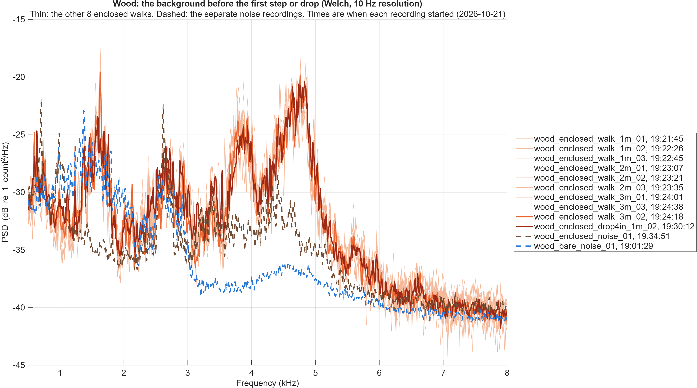

# Morlet wavelet transform (MATLAB)

Wavelet transform code from Luis M. Baldelomar Pinto (Prof. Vakakis's lab, LNDVL), sent to the team on 2026-10-27. `Example.m`, `plotwt.m` and `freq_inst_morlet.m` are as received; the other files are ours. Everything here was run in MATLAB R2025a on 2026-10-28.

| File | What it does |
|---|---|
| `freq_inst_morlet.m` | The transform. Takes the FFT of the signal, multiplies it by a Gaussian (the Morlet wavelet in the frequency domain) centered on each analysis frequency, and inverse-FFTs back to time. Returns the magnitude `|W|` as an N x `nf` matrix, and the complex transform if asked for a fourth output. |
| `plotwt.m` | Pads the ends of the signal by mirroring it (to reduce edge artifacts), runs the transform, crops back to the original samples, and plots the scalogram normalized to its own maximum. |
| `Example.m` | Two demos: a sum of sines at 20, 40 and 85 Hz, and a shock (a 1 ms half-sine pulse). |
| `compare_floors_wavelet.m` | Runs the transform on single steps from several of our trials and plots them on one shared dB scale, with a table of peak levels. Use this one to compare floors. |
| `wavelet_conditions.m` | The carpet against wood, bare against enclosed comparison of all the 2026-10-21 drops and steps: band levels, ring times and ringing frequencies per event and per group, each measured against its own trial's background, and the background spectra, written to CSVs, with figures. See [below](#carpet-against-wood-bare-against-enclosed). |
| `wavelet_window.m`, `wavelet_band_metrics.m`, `wavelet_params.m` | Used by `wavelet_conditions.m`: the transform of one window, the metrics of one window, and every parameter in one place. |
| `test_wavelet_metrics.m` | Checks the metrics on synthetic signals and against `comparison.csv`. |

## Comparing floors

From the repo root:

```matlab
addpath('matlab/wavelet')
compare_floors_wavelet()     % events 2 to 4 of carpet_bare_walk_1m_01 against wood_bare_walk_1m_01
compare_floors_wavelet(["carpet_bare_walk_2m_01" "wood_bare_walk_2m_01"], 1:5)
R = compare_floors_wavelet(SaveAs="steps.png");   % also save the figure and keep the table
```

Each row of the figure is a trial and each column an event. Events are det-v1 event numbers from `data/controlled/analysis/<date>/events_<trial>.csv`; some events are not steps (`walking_steps_review.csv` lists them), so check the event times before choosing. Options: `Date`, `Pre` and `Post` (window in s around the event, default 0.10 and 0.25), `Pad`, `Fmin`, `Fmax`, `Nf`, `Fa` (default 50 Hz, 10 kHz, 300, 2), `RangeDb` (default 40) and `SaveAs`. `help compare_floors_wavelet` has the details.

The table gives, per event, the strongest point (`peak_db`, `peak_ms`, `peak_hz`) and the strongest point at or above 1 kHz (`peak_above_1khz_*`). Levels are dB relative to the strongest point in any panel, and times are ms from the event time.

Why it does not just call `plotwt` on each step:

- **Shared scale.** `plotwt` divides each plot by its own maximum, so colors in two plots cannot be compared. This divides every panel by one shared maximum.
- **dB, not linear.** Most steps have their strongest point below about 120 Hz (5 of the 6 in the default run). On a linear scale that peak sets the maximum and the content above 1 kHz comes out nearly white.
- **Amplitude correction.** `|W|` for a steady sine of amplitude `A` at `f` is `A*sqrt(Fa/(2*f))`, so low frequencies read stronger than they are (in `Example.m` the 85 Hz sine has twice the amplitude of the 20 Hz one, but its band peaks at about the same level). This divides by `sqrt(Fa/(2*f))` so a sine of amplitude `A` reads `A` at every frequency.
- **Window starts early.** det-v1 marks a step after it starts: in the default run the burst starts 10 to 50 ms before the event time. So the window starts 100 ms before it.
- **Real padding.** It transforms 100 ms of real signal on each side of the window and then crops it, instead of mirroring.
- **Memory.** Our recordings are 48 kHz, so it works on one step at a time. A whole 10 s walking trial at 500 frequencies needs about 2 GB for the result alone.

Default run (bare sensor, 1 m, 2026-10-21):

| Event | Carpet: peak above 1 kHz (dB) | Wood: peak above 1 kHz (dB) |
|---|---|---|
| 2 | -28.8 | -17.5 |
| 3 | -35.5 | -8.5 |
| 4 | -22.4 | -21.7 |

On carpet the content above 1 kHz is over within about 40 ms of the event time. On wood it is stronger in events 2 and 3, reaches higher (up to about 10 kHz in event 2), and has later bursts 60 to 100 ms after the event time. Event 4's peak above 1 kHz is about the same on both floors, and carpet event 3 is weak at all frequencies, so the difference varies a lot from step to step: compare more steps and trials before drawing a conclusion.

## Using the lab's functions directly

```matlab
plotwt(t, x, F0, Ff, Fn, Fa, miri, mirf, chp1, chp2, Label)
```

| Argument | Meaning |
|---|---|
| `t`, `x` | Time (s) and signal, uniformly sampled |
| `F0`, `Ff` | Lowest and highest frequency to analyze (Hz). `F0` must be above 0 |
| `Fn` | Number of frequencies, spaced linearly from `F0` to `Ff` |
| `Fa` | Morlet center frequency: about how many cycles the wavelet spans. 2 to 6 is typical |
| `miri`, `mirf` | Padding at the start and end: `'o'` odd mirror (flipped about the end sample, keeps value and slope continuous), `'e'` even mirror (plain reflection), `''` none |
| `chp1`, `chp2` | Fraction of the signal length used for the start and end padding |
| `Label` | `'IMF'` squares the plotted magnitude (energy). Anything else plots the magnitude |

`Fa` sets the time-frequency trade-off. At frequency `f` the wavelet's time spread is about `Fa/f` seconds and its bandwidth about `f/(2*pi*Fa)` Hz, so a smaller `Fa` (the shock demo uses 2) localizes impacts better in time, and a larger one separates nearby frequencies better. A shock shows as a vertical stripe that smears out in time toward low frequencies.

For a signal that starts right at an impact (as in the shock demo), use no padding at the start: mirroring would copy the impact into negative time.

A quick look at one step with `plotwt` (linear scale, normalized to its own maximum):

```matlab
addpath('matlab/wavelet')
trial = 'wood_bare_walk_1m_01';
m  = load(fullfile('data/controlled/raw/2026-10-21', [trial '.mat']));
ev = readtable(fullfile('data/controlled/analysis/2026-10-21', ['events_' trial '.csv']));
fs = m.fs_hz;  x = double(m.counts(:));  t = (0:numel(x)-1)'/fs;

ts = ev.t_s(2);                          % second detected step
k  = t >= ts - 0.10 & t <= ts + 0.25;    % 100 ms before to 250 ms after
figure
plotwt(t(k), x(k), 50, 10000, 300, 2, 'e', 'e', 0.2, 0.2, 'sig')
```

`Example.m` draws its signals in black (`'k-'`), so they do not show on MATLAB's dark theme; switch MATLAB to the light theme to see them.

## Carpet against wood, bare against enclosed

On 2026-10-21 the enclosure raised the signal on carpet and lowered it on wood. `wavelet_conditions.m` asks whether that is an enclosure resonance (a band that keeps ringing after the impact, in the enclosed recordings only) or a floor effect (the carpet acting as a spring under the base, so longer and lower ringing on carpet in both conditions).

An earlier version of this section (commits a8cd929 and caeb59b) measured every event against the separate noise recording of its condition. On wood, enclosed, that recording (`wood_enclosed_noise_01`) was made after the trials and was quieter than the background during them, so the analysis counted the background as ringing, and the Summary overstated the case for a resonance and said the enclosure made steps ring longer. This version measures every event against its own trial's background.

### Summary

Every number here is in `wavelet_summary.csv`, `wavelet_events.csv` or `wavelet_background.csv`; "Results" and "Caveats" below have the detail.

- **Background on wood, enclosed:** before any step or drop, the enclosed recordings on wood have a hump at 4.5 to 4.9 kHz that the bare ones do not. In the quiet segments of all 9 enclosed walks (19:21 to 19:24) the spectrum peaks at 4540 to 4860 Hz, 15.3 to 19.0 dB above `wood_bare_noise_01` at the same frequency, and the 4-5 kHz band power is +4.5 to +5.4 dB re 1 count², against -6.5 to -7.4 dB for the bare walks. The one enclosed drop with a long quiet segment (19:30) is the same (4830 Hz, +5.1 dB). `wood_enclosed_noise_01`, started at 19:34:51, about 10 minutes after the walks, peaks lower and weaker: 4410 Hz, 8.7 dB above bare noise, 4-5 kHz power -2.5 dB. Every later enclosed recording, on carpet, peaks at 4250 to 4480 Hz.
- **Background at 1.2 to 1.8 kHz:** every wood recording except `wood_enclosed_noise_01` has a broad background there, bare included (1.5-1.8 kHz power -3.8 to +0.1 dB for the bare walks, -1.5 to +0.5 dB for the enclosed walks, -10.2 dB for `wood_enclosed_noise_01`). On top of it, all 9 enclosed walks have a narrow line at 1630 to 1640 Hz.
- **What changed from the earlier version:** against each trial's own background, the enclosed steps no longer ring at a fixed 1.59 kHz (500-2000 Hz medians 862, 1011 and 1574 Hz at 1, 2 and 3 m; per-trial medians 564 to 1623 Hz).
- **Steps:** after a step at 1 m, the first 20 dB of 2-8 kHz decay takes about as long enclosed as bare (median 9.3 against 7.5 ms). The enclosed envelope then comes back within 20 dB of its peak, so it takes longer to stay down: 44.7 against 12.7 ms, with 14 of 31 and 16 of 30 steps resolving. All 14 resolved enclosed steps peak at least 30 dB above their own background (`band_peak_db` minus `floor_env_db` in `wavelet_events.csv`), so the 20 dB threshold sits at least 10 dB above the median background and the tail is the step's. At 2 and 3 m almost no steps resolve (0 and 2 of 30 enclosed), so the ring times there say nothing either way.
- **Drops:** the background is at most -32.6 dB (0.05%) of a wood drop's window energy in any band, so the drop levels stand. On wood the enclosure lowers 500-2000 Hz by 6.1 to 7.1 dB and raises 2-8 kHz by 4.7 to 13.8 dB at every radius. Enclosed drops on wood ring at 3841 to 4702 Hz in 2-8 kHz in 8 of 9 trials (per-trial medians), against 2318 to 2947 Hz bare, with their 2-8 kHz peaks 52 to 73 dB above the background: the impacts excite the same 4 to 5 kHz region that the background shows.
- **Carpet:** the enclosure raises 100-500 Hz at 1 m (drops +5.5 dB, steps +5.3 dB), where the background is a small share of the window (median -43.0 and -45.5 dB for the bare and enclosed drops, -21.0 and -24.0 dB for the steps). Above 500 Hz the background is a large part of a carpet step's window (median share -0.4 to -2.1 dB, except 500-2000 Hz at 1 m: -6.2 and -7.7 dB), and the enclosed background there is 2.5 to 3.8 dB above the bare one, about the size of the +2.4 to +4.6 dB enclosed minus bare. The enclosed carpet drops do not shift their 2-8 kHz ringing toward 4 to 5 kHz (group medians 2683 to 3378 Hz, against 3047 to 3113 Hz bare).
- **Carpet as a spring** is not tested by this analysis: nothing below 100 Hz is analyzed, and in 100-500 Hz most ringing frequencies are also peaks of the background.
- **Verdict:** on wood, the enclosed setup has a resonance region at about 4 to 5 kHz. It is in the enclosed background only, impacts excite it far above that background, and its peak moved from about 4.8 to 4.4 kHz between 19:30 and 19:35. The recordings do not say why (the base re-seated, something near it moved, or a source of the background changing). The enclosure does not make steps decay more slowly in their first 20 dB; at 1 m a weaker tail lasts longer.

### Running it

From the repo root:

```matlab
addpath('matlab/wavelet')
wavelet_conditions()      % about 4 minutes; writes the CSVs and figures listed below
test_wavelet_metrics()    % the checks in "Validation"
```

Outputs:

- `data/controlled/analysis/2026-10-21/wavelet_events.csv`: one row per event (387), with the parameters, the floor used and where it came from on every row.
- `data/controlled/analysis/2026-10-21/wavelet_summary.csv`: one row per excitation, floor, condition and radius (24): number of events, median, min and max, and each trial's median (in trial order; `nr` when none of its events resolved), and on the enclosed rows the enclosed minus bare difference of the medians.
- `data/controlled/analysis/2026-10-21/wavelet_background.csv`: the quiet segment of every trial and noise recording that has one of at least 0.3 s (80 rows, in recording order): Welch spectrum peaks in 4.0-5.1 kHz and 1.5-1.8 kHz, how far each is above the condition's and the floor's bare noise recording at the same frequency, and the 4-5 kHz and 1.5-1.8 kHz band powers.
- `data/controlled/figures/2026-10-21/wavelet_drop4in_1m.png`, `wavelet_drop4in_2m.png`, `wavelet_walk_1m.png`, `wavelet_walk_2m.png`: scalograms, rows carpet and wood, columns bare and enclosed, one shared dB scale per figure. Each panel is the event whose three band levels are closest to its group's median (Euclidean distance in dB).
- `data/controlled/figures/2026-10-21/wavelet_ring_times.png`: the ring time of every event, by band, floor, condition and radius.
- `data/controlled/figures/2026-10-21/wavelet_background_spectra.png`: the quiet-segment spectra on wood, enclosed against bare, with the two wood noise recordings.

### Method

Events:

- **Drops first**, the controlled excitation (same mass, height, flat tip and impact point): the 37 `drop4in` trials. `drop7in` (carpet, bare, 1 m only) is left out. Each trial was one drop (`impacts_made` is 1 in all 37), but det-v1 found 1 to 4 events per trial (13 trials with 1, 16 with 2, 7 with 3, 1 with 4). **Rule: the drop is the det-v1 event with the highest `peak_db`.** Checked by eye on the waveform around every event of all 37 trials: every other event is at least 12.3 dB weaker (the closest is in `wood_enclosed_drop4in_1m_02`); the 8 events before a drop are 0.25 to 1.44 s earlier, at most 25.4 dB, and noise-like with no impulsive start (handling); the 25 after a drop are 0.25 to 0.58 s later and are bounces, a smaller impulse with its own ringing. It is also the impact `scripts/compare_conditions.py` uses.
- **Then steps**: rebuilt as `walking_trials()` in `scripts/plot_floor_slide_figures.py` does (the det-v1 events in `events_<trial>.csv`, less those within 0.05 s of a time in the review's `not_steps_at`, plus its `missed_at`, from `walking_steps_review.csv`). 350 steps in 35 trials (21 of them from `missed_at`), every count equal to `steps_in_signal`; `wood_bare_walk_3m_01` is left out (the review could not decide). The MATLAB list matches the Python one step for step.
- Groups are floor x condition x radius (1, 2, 3 m), separately for drops and steps. Radii and excitations are never pooled.

Transform and window:

- `freq_inst_morlet` unchanged, 100 Hz to 10 kHz in 300 linearly spaced frequencies (33.1 Hz apart), Fa = 2. 100 Hz because the VPU's specified band starts there and det-v1 high-passes there too.
- Window: 100 ms before the event time to 250 ms after, transformed with 100 ms of real signal on each side and then cropped, one window at a time. If the next det-v1 event or missed step falls inside the window, the window ends 10 ms before it: this happened once (`carpet_enclosed_walk_2m_03` step 7, 189 ms instead of 350 ms).
- **Normalization, one throughout:** amplitude-corrected magnitude, `|W| / sqrt(Fa/(2f))`, as in `compare_floors_wavelet.m`, so a steady sine of amplitude A counts reads A at its frequency. For a broadband impact this weights each frequency by about f, so **levels compare only within a band**, never between bands.
- Band envelope: at each sample, the RMS of the corrected magnitude over the band's frequencies (100-500 Hz, 500-2000 Hz, 2-8 kHz; lower edge included).

Floor (the background):

- Each trial's **quiet segment** runs from 1.0 s after the start of the recording to 0.15 s before its first det-v1 event. It goes through the same transform in windows as long as an event window, padded inside the segment, as many as fit without overlapping (up to 40). The floor is the median band envelope (for the ring time), the median squared magnitude at each frequency (for the ringing frequency) and the mean square band envelope (for the background share).
- Where the quiet segment is too short for one window with its padding (0.55 s), the floor is the median of the other trials of the same floor, condition and excitation that have one, and if none do, of the same floor and condition; `floor_source` and `floor_from` in `wavelet_events.csv` say which. 54 trials have their own; 18 borrow: the 9 carpet enclosed drops (from the 9 carpet enclosed walks, since no carpet enclosed drop has a long enough segment), 8 wood enclosed drops (from `wood_enclosed_drop4in_1m_02`) and `wood_bare_walk_1m_02` (from the other 7 wood bare walks).
- The floor of each condition's separate noise recording is kept as `noise_rec_env_db_*`. On wood, enclosed, the trials' own floors are 3.9 to 4.6 dB above it in 2-8 kHz (-0.4 to +0.3 against -4.3 dB re 1 count) and 2.7 to 3.4 dB above it in 500-2000 Hz; everywhere else they are within 1.8 dB of it.

Per event and band (`wavelet_band_metrics.m`):

- **Level**: 10 log10 of the band envelope's energy over the window, in dB re 1 count² s.
- **Background share**: the floor's mean square envelope times the window length, over the window's energy, in dB (0 dB: the window is all background).
- **Ring time**: from the envelope's peak until it stays 20 dB below that peak. Not resolved, never a number, if the envelope reaches the floor first (or the peak is less than 20 dB above it), or is still within 20 dB of the peak when the window ends. `ring_first_ms` is when the envelope first falls 20 dB below the peak, whether or not it stays there; it differs from the ring time when something re-excites the band, such as a bounce.
- **Ringing frequency**: of the energy from 20 to 100 ms after the band peak (at least 40 ms of that inside the window), the strongest local maximum inside the band (not its lowest or highest analyzed frequency) that is at least 10 dB above the floor there; otherwise "no peak in band". `ring_hz_in_background` is "yes" when the floor's spectrum also has a local maximum within one frequency (33.1 Hz) of it.
- **Overall peak**: time, frequency and level of the largest corrected value at any frequency.

Background spectra (`wavelet_background.csv`, `wavelet_background_spectra.png`): Welch spectra (4800-sample Hann segments, half overlapping: 10 Hz resolution) of every quiet segment of at least 0.3 s, and of each noise recording after its first 1.0 s.

27 trials name another condition's noise recording in their sidecar's `baseline_noise_id`. Neither that nor the condition's own noise recording is the floor here (see above), but for the record:

| Trials | `baseline_noise_id` in the sidecar | The condition's own noise recording |
|---|---|---|
| `carpet_enclosed_drop4in_1m_01` to `_3m_03` (9) | `carpet_bare_noise_01` | `carpet_enclosed_noise_01` |
| `wood_enclosed_drop4in_1m_01` to `_3m_03` (9) | `wood_bare_noise_01` | `wood_enclosed_noise_01` |
| `wood_enclosed_walk_1m_01` to `_3m_03` (9) | `wood_bare_noise_01` | `wood_enclosed_noise_01` |

### Validation

`test_wavelet_metrics()` output (2026-10-28):

```
1. 1 kHz sine, amplitude 100: reads 99.71 to 99.71 (median 99.71) at 994 Hz, largest error 0.29%: PASS
2. 4.5 kHz sine, 20 dB decay in 10 ms: ring time 10.17 ms (resolved), ringing frequency 4504 Hz: PASS
2. 4.5 kHz sine, 20 dB decay in 40 ms: ring time 40.10 ms (resolved), ringing frequency 4504 Hz: PASS
2b. 1.9 kHz sine: ringing frequency 1888 Hz in 500-2000 Hz; 2-8 kHz: no peak in band: PASS
   Impulse, 100-500 Hz: ring time 18.23 ms (not checked: the resolution limit)
   Impulse, 500-2000 Hz: ring time 4.15 ms (not checked: the resolution limit)
   Impulse, 2-8 kHz: ring time 1.06 ms (not checked: the resolution limit)
3. drop4in carpet 1 m 100-500 Hz  comparison.csv  +6.6 dB (separated: yes), wavelet  +5.5 dB: same sign
3. drop4in carpet 1 m 500-2000 Hz comparison.csv  -7.7 dB (separated: no ), wavelet  -8.1 dB: same sign
3. drop4in carpet 1 m 2-8 kHz     comparison.csv  -3.5 dB (separated: no ), wavelet  -2.5 dB: same sign
3. drop4in carpet 2 m 100-500 Hz  comparison.csv  +3.8 dB (separated: yes), wavelet  +3.0 dB: same sign
3. drop4in carpet 2 m 500-2000 Hz comparison.csv  +0.7 dB (separated: no ), wavelet  +1.4 dB: same sign
3. drop4in carpet 2 m 2-8 kHz     comparison.csv +11.9 dB (separated: yes), wavelet +12.8 dB: same sign
3. drop4in carpet 3 m 100-500 Hz  comparison.csv  +1.2 dB (separated: no ), wavelet  -0.6 dB: DIFFERENT SIGN
3. drop4in carpet 3 m 500-2000 Hz comparison.csv  -3.5 dB (separated: no ), wavelet  -2.9 dB: same sign
3. drop4in carpet 3 m 2-8 kHz     comparison.csv  +7.3 dB (separated: yes), wavelet  +6.5 dB: same sign
3. drop4in wood   1 m 100-500 Hz  comparison.csv  -1.9 dB (separated: no ), wavelet  -1.5 dB: same sign
3. drop4in wood   1 m 500-2000 Hz comparison.csv  -6.4 dB (separated: yes), wavelet  -7.1 dB: same sign
3. drop4in wood   1 m 2-8 kHz     comparison.csv  +4.0 dB (separated: no ), wavelet  +4.7 dB: same sign
3. drop4in wood   2 m 100-500 Hz  comparison.csv  +0.5 dB (separated: no ), wavelet  -0.7 dB: DIFFERENT SIGN
3. drop4in wood   2 m 500-2000 Hz comparison.csv  -4.8 dB (separated: no ), wavelet  -6.1 dB: same sign
3. drop4in wood   2 m 2-8 kHz     comparison.csv +10.4 dB (separated: yes), wavelet +12.2 dB: same sign
3. drop4in wood   3 m 100-500 Hz  comparison.csv  -6.8 dB (separated: yes), wavelet  -5.5 dB: same sign
3. drop4in wood   3 m 500-2000 Hz comparison.csv  -8.0 dB (separated: yes), wavelet  -6.7 dB: same sign
3. drop4in wood   3 m 2-8 kHz     comparison.csv +10.4 dB (separated: yes), wavelet +13.8 dB: same sign
3. drop4in: 16 of 18 bands have the same sign
3. walk    carpet 1 m 100-500 Hz  comparison.csv  +2.3 dB (separated: yes), wavelet  +5.3 dB: same sign
3. walk    carpet 1 m 500-2000 Hz comparison.csv  +2.3 dB (separated: no ), wavelet  +4.2 dB: same sign
3. walk    carpet 1 m 2-8 kHz     comparison.csv  +4.1 dB (separated: yes), wavelet  +2.7 dB: same sign
3. walk    carpet 2 m 100-500 Hz  comparison.csv  -1.1 dB (separated: yes), wavelet  -1.6 dB: same sign
3. walk    carpet 2 m 500-2000 Hz comparison.csv  +3.6 dB (separated: yes), wavelet  +4.6 dB: same sign
3. walk    carpet 2 m 2-8 kHz     comparison.csv  +3.8 dB (separated: yes), wavelet  +3.1 dB: same sign
3. walk    carpet 3 m 100-500 Hz  comparison.csv  +7.0 dB (separated: yes), wavelet  +3.5 dB: same sign
3. walk    carpet 3 m 500-2000 Hz comparison.csv  +3.2 dB (separated: yes), wavelet  +3.4 dB: same sign
3. walk    carpet 3 m 2-8 kHz     comparison.csv  +2.4 dB (separated: yes), wavelet  +2.4 dB: same sign
3. walk    wood   1 m 100-500 Hz  comparison.csv  -2.1 dB (separated: yes), wavelet  -0.3 dB: same sign
3. walk    wood   1 m 500-2000 Hz comparison.csv  -9.5 dB (separated: yes), wavelet -10.7 dB: same sign
3. walk    wood   1 m 2-8 kHz     comparison.csv  +5.6 dB (separated: yes), wavelet  +6.3 dB: same sign
3. walk    wood   2 m 100-500 Hz  comparison.csv  +1.8 dB (separated: yes), wavelet  +0.1 dB: same sign
3. walk    wood   2 m 500-2000 Hz comparison.csv  -6.4 dB (separated: yes), wavelet  -4.2 dB: same sign
3. walk    wood   2 m 2-8 kHz     comparison.csv +13.2 dB (separated: yes), wavelet +12.9 dB: same sign
3. walk    wood   3 m 100-500 Hz  comparison.csv  +2.4 dB (separated: no ), wavelet  +1.7 dB: same sign
3. walk    wood   3 m 500-2000 Hz comparison.csv -11.6 dB (separated: yes), wavelet  -9.9 dB: same sign
3. walk    wood   3 m 2-8 kHz     comparison.csv  +7.7 dB (separated: yes), wavelet +10.5 dB: same sign
3. walk: 18 of 18 bands have the same sign (walking: printed, not checked)
Error using test_wavelet_metrics (line 127)
At least one check failed (see above).
```

Checks 1, 2 and 2b pass. Check 3 fails in 2 of the 18 drop bands, and both are differences neither method can resolve:

- **Carpet, 3 m, 100-500 Hz** (comparison.csv +1.2 dB, wavelet -0.6 dB). comparison.csv marks it not separated: its bare trial medians are 38.8, 40.0 and 40.8 dB and its enclosed ones 40.2, 41.2 and 41.3 dB. The wavelet trial medians overlap the same way (bare 19.7, 18.7, 20.3; enclosed 19.1, 19.1, 17.8).
- **Wood, 2 m, 100-500 Hz** (+0.5 dB against -0.7 dB). Not separated either: comparison.csv bare 47.5, 48.1, 55.2 and enclosed 47.5, 48.6, 48.8; wavelet bare 29.7, 34.3, 30.5 and enclosed 29.8, 29.5, 29.9.

In both, the difference is under 1.3 dB and smaller than the spread between trials, so its sign is not established by either measure. The two also measure different things: comparison.csv takes a 50 ms RMS through a band filter around the detection peak, and this takes the energy of the corrected wavelet magnitude over 350 ms, which at 100 Hz is smoothed over about 20 ms by the wavelet itself. Every drop band that comparison.csv marks as separated (9 of 18) has the same sign here, and so do all 18 walking bands. The levels do not depend on the floor, so these results are the same as in the earlier version.

The impulse lines are the shortest ring time the transform can show in each band: 18.2 ms in 100-500 Hz, 4.2 ms in 500-2000 Hz and 1.1 ms in 2-8 kHz. Ring times near these are the wavelet, not the floor.

### Results

From `wavelet_summary.csv`. Level: median, dB re 1 count² s, with enclosed minus bare in brackets on the enclosed rows. Floor from: "own" when every trial in the group has its own quiet segment, otherwise how many do. Background share: median (and max) over the group's events, dB. Ring: median ring time in ms over the events that resolved (resolved / events). First 20 dB: median `ring_first_ms`. Ringing: median ringing frequency in Hz (events with one; how many of those are also a peak of the background, "bg"). `nr`: none resolved.

4 in drops, levels and background:

| Floor | r | Condition | n | Floor from | 100-500 Hz level | 500-2000 Hz level | 2-8 kHz level | 100-500 Hz background share | 500-2000 Hz background share | 2-8 kHz background share |
|---|---|---|---|---|---|---|---|---|---|---|
| carpet | 1 m | bare | 3 | own | 30.4 | 37.8 | 23.1 | -43 (max -40.4) | -51.1 (max -39.7) | -35 (max -24.4) |
| carpet | 1 m | enclosed | 3 | own 0/3 | 35.9 (+5.5) | 29.7 (-8.1) | 20.6 (-2.5) | -45.5 (max -43.5) | -39.8 (max -36.2) | -29.9 (max -29.8) |
| carpet | 2 m | bare | 3 | own | 23.5 | 15.6 | -3 | -35.6 (max -32.4) | -29.1 (max -28.2) | -8.9 (max -8.7) |
| carpet | 2 m | enclosed | 3 | own 0/3 | 26.5 (+3.0) | 17 (+1.4) | 9.8 (+12.8) | -36.1 (max -34.5) | -27 (max -26.1) | -19.1 (max -18.1) |
| carpet | 3 m | bare | 3 | own | 19.7 | 17.6 | -1.6 | -30.9 (max -30.3) | -30.2 (max -23.2) | -10.2 (max -8.6) |
| carpet | 3 m | enclosed | 3 | own 0/3 | 19.1 (-0.6) | 14.7 (-2.9) | 4.9 (+6.5) | -28.7 (max -27.4) | -24.8 (max -23.3) | -14.2 (max -11.6) |
| wood | 1 m | bare | 4 | own | 44.4 | 46.9 | 37.6 | -57 (max -54.7) | -53.7 (max -49.9) | -48.3 (max -45.9) |
| wood | 1 m | enclosed | 3 | own 1/3 | 42.9 (-1.5) | 39.8 (-7.1) | 42.3 (+4.7) | -55 (max -52.8) | -48 (max -46.8) | -46 (max -45.7) |
| wood | 2 m | bare | 3 | own | 30.5 | 36.4 | 24.6 | -43.7 (max -42.9) | -43.3 (max -38.9) | -35.8 (max -35.7) |
| wood | 2 m | enclosed | 3 | own 0/3 | 29.8 (-0.7) | 30.3 (-6.1) | 36.8 (+12.2) | -41.9 (max -41.6) | -38.5 (max -38.5) | -40.5 (max -39.6) |
| wood | 3 m | bare | 3 | own | 27.2 | 36.4 | 22.8 | -40.8 (max -39.8) | -42.7 (max -42.5) | -33.8 (max -32.6) |
| wood | 3 m | enclosed | 3 | own 0/3 | 21.7 (-5.5) | 29.7 (-6.7) | 36.6 (+13.8) | -33.8 (max -33) | -37.8 (max -37.2) | -40.2 (max -37) |

4 in drops, ringing:

| Floor | r | Condition | 100-500 Hz ring (ms) | first 20 dB (ms) | ringing (Hz) | 500-2000 Hz ring (ms) | first 20 dB (ms) | ringing (Hz) | 2-8 kHz ring (ms) | first 20 dB (ms) | ringing (Hz) |
|---|---|---|---|---|---|---|---|---|---|---|---|
| carpet | 1 m | bare | 36.9 (3/3) | 36.9 | 166 (3; 3 bg) | 5.9 (3/3) | 5.9 | 795 (3; 0 bg) | 2.1 (3/3) | 2.1 | 3113 (3; 1 bg) |
| carpet | 1 m | enclosed | 31.8 (3/3) | 31.8 | 166 (3; 0 bg) | 15 (3/3) | 15 | 696 (3; 3 bg) | 40.6 (3/3) | 5.2 | 3378 (3; 1 bg) |
| carpet | 2 m | bare | 69.9 (3/3) | 69.9 | 166 (3; 3 bg) | 34.2 (3/3) | 33.8 | 828 (3; 1 bg) | 95.6 (1/3) | 35.6 | 3047 (3; 1 bg) |
| carpet | 2 m | enclosed | 106.7 (3/3) | 36.1 | 133 (3; 0 bg) | 72.4 (3/3) | 30.5 | 994 (3; 3 bg) | 76.2 (3/3) | 18.6 | 2683 (3; 1 bg) |
| carpet | 3 m | bare | 97.6 (3/3) | 97.6 | 199 (3; 2 bg) | 35.7 (3/3) | 29.5 | 928 (3; 1 bg) | 87.7 (1/3) | 38.9 | 3080 (3; 0 bg) |
| carpet | 3 m | enclosed | 142.6 (2/3) | 70.5 | 166 (3; 1 bg) | 64.1 (3/3) | 32.4 | 961 (3; 3 bg) | 72.9 (2/3) | 39 | 3345 (3; 1 bg) |
| wood | 1 m | bare | 165.6 (4/4) | 30 | 183 (4; 4 bg) | 186.8 (4/4) | 18.5 | 1342 (4; 1 bg) | 128.7 (4/4) | 9 | 2435 (4; 3 bg) |
| wood | 1 m | enclosed | 196.2 (3/3) | 27.1 | 199 (3; 3 bg) | 180.4 (3/3) | 28 | 564 (3; 1 bg) | 208.1 (3/3) | 33.6 | 4669 (3; 1 bg) |
| wood | 2 m | bare | 201.7 (3/3) | 64.5 | 266 (3; 1 bg) | 169.3 (3/3) | 29.6 | 1789 (3; 0 bg) | 152.5 (3/3) | 40.5 | 2583 (3; 2 bg) |
| wood | 2 m | enclosed | 222.9 (1/3) | 59.4 | 299 (3; 0 bg) | 186 (2/3) | 59 | 1590 (3; 3 bg) | 180.3 (2/3) | 53.8 | 3908 (3; 0 bg) |
| wood | 3 m | bare | 226.4 (1/3) | 78.4 | 133 (3; 1 bg) | 212 (3/3) | 30.9 | 1458 (3; 0 bg) | 145.5 (3/3) | 58.7 | 2848 (3; 1 bg) |
| wood | 3 m | enclosed | nr (0/3) | 66.7 | 133 (3; 3 bg) | 223.2 (2/3) | 69.1 | 1590 (3; 3 bg) | 188 (3/3) | 63.8 | 4537 (3; 1 bg) |

Walking steps, levels and background:

| Floor | r | Condition | n | Floor from | 100-500 Hz level | 500-2000 Hz level | 2-8 kHz level | 100-500 Hz background share | 500-2000 Hz background share | 2-8 kHz background share |
|---|---|---|---|---|---|---|---|---|---|---|
| carpet | 1 m | bare | 30 | own | 9.1 | -7.3 | -10.2 | -21 (max -15.3) | -6.2 (max -0.4) | -1.8 (max -0.8) |
| carpet | 1 m | enclosed | 30 | own | 14.4 (+5.3) | -3.1 (+4.2) | -7.5 (+2.7) | -24 (max -12.1) | -7.7 (max -0.8) | -2.1 (max -0.6) |
| carpet | 2 m | bare | 30 | own | 3.7 | -12.8 | -10.9 | -16 (max -5.7) | -0.9 (max 0.6) | -1 (max -0.4) |
| carpet | 2 m | enclosed | 30 | own | 2.1 (-1.6) | -8.2 (+4.6) | -7.8 (+3.1) | -11.7 (max -2.4) | -1.4 (max 0.6) | -1.4 (max -0.8) |
| carpet | 3 m | bare | 29 | own | -1 | -12.9 | -11 | -11.2 (max -5.3) | -0.4 (max 0.4) | -1 (max -0.1) |
| carpet | 3 m | enclosed | 30 | own | 2.5 (+3.5) | -9.5 (+3.4) | -8.6 (+2.4) | -12.1 (max -1.1) | -0.7 (max 0.1) | -0.7 (max -0.2) |
| wood | 1 m | bare | 30 | own 2/3 | 10.2 | 10.5 | 0.4 | -23.4 (max -12.9) | -17.3 (max -4.4) | -11.2 (max -3.6) |
| wood | 1 m | enclosed | 31 | own | 9.9 (-0.3) | -0.2 (-10.7) | 6.7 (+6.3) | -22.4 (max -9) | -7.4 (max -1) | -10.9 (max -3.3) |
| wood | 2 m | bare | 30 | own | 7.7 | 1.7 | -8.4 | -20.2 (max -7.9) | -8.4 (max -3.6) | -2.3 (max -0.8) |
| wood | 2 m | enclosed | 30 | own | 7.8 (+0.1) | -2.5 (-4.2) | 4.5 (+12.9) | -20.5 (max -12) | -5.3 (max -0.8) | -7.9 (max -1.9) |
| wood | 3 m | bare | 20 | own | 2 | 8 | -8 | -15.3 (max -9.7) | -14.1 (max -6.5) | -2.8 (max -0.8) |
| wood | 3 m | enclosed | 30 | own | 3.7 (+1.7) | -1.9 (-9.9) | 2.5 (+10.5) | -15.7 (max -7) | -5.8 (max -0.8) | -6.2 (max -1.2) |

Walking steps, ringing:

| Floor | r | Condition | 100-500 Hz ring (ms) | first 20 dB (ms) | ringing (Hz) | 500-2000 Hz ring (ms) | first 20 dB (ms) | ringing (Hz) | 2-8 kHz ring (ms) | first 20 dB (ms) | ringing (Hz) |
|---|---|---|---|---|---|---|---|---|---|---|---|
| carpet | 1 m | bare | 76.9 (30/30) | 76.9 | 199 (15; 11 bg) | 23 (9/30) | 27.8 | 928 (7; 1 bg) | 2.5 (1/30) | 27.2 | 2451 (2; 0 bg) |
| carpet | 1 m | enclosed | 82.7 (29/30) | 82.2 | 166 (17; 9 bg) | 16.4 (5/30) | 16.6 | 994 (3; 3 bg) | 7.4 (2/30) | 18.3 | none (0) |
| carpet | 2 m | bare | 95.2 (18/30) | 95.8 | 183 (2; 1 bg) | nr (0/30) | 60.1 | 978 (4; 4 bg) | nr (0/30) | 71.5 | none (0) |
| carpet | 2 m | enclosed | 83.5 (11/30) | 85.8 | 166 (5; 0 bg) | nr (0/30) | 12.7 | none (0) | nr (0/30) | nr | none (0) |
| carpet | 3 m | bare | 121.1 (4/29) | 126.6 | none (0) | nr (0/29) | nr | none (0) | nr (0/29) | nr | none (0) |
| carpet | 3 m | enclosed | 84.3 (10/30) | 90.5 | 464 (1; 0 bg) | nr (0/30) | 20.1 | none (0) | nr (0/30) | nr | none (0) |
| wood | 1 m | bare | 66.6 (29/30) | 66.3 | 166 (27; 25 bg) | 15.5 (19/30) | 11.5 | 1292 (15; 4 bg) | 12.7 (16/30) | 7.5 | 2451 (19; 1 bg) |
| wood | 1 m | enclosed | 68.6 (29/31) | 68.6 | 232 (30; 26 bg) | 58.1 (7/31) | 38.8 | 862 (23; 4 bg) | 44.7 (14/31) | 9.3 | 4355 (24; 2 bg) |
| wood | 2 m | bare | 78.3 (25/30) | 82.5 | 166 (15; 15 bg) | 21.7 (10/30) | 9.3 | 1424 (10; 2 bg) | 3.9 (2/30) | 9.5 | 3163 (2; 0 bg) |
| wood | 2 m | enclosed | 96 (30/30) | 94.6 | 199 (28; 22 bg) | nr (0/30) | 87.5 | 1011 (16; 6 bg) | nr (0/30) | 3.3 | 3775 (25; 2 bg) |
| wood | 3 m | bare | 80.8 (17/20) | 88.8 | 133 (15; 8 bg) | 36.2 (11/20) | 10.8 | 1358 (13; 3 bg) | nr (0/20) | 102.6 | 2616 (4; 3 bg) |
| wood | 3 m | enclosed | 78.8 (17/30) | 87 | 133 (28; 18 bg) | 104 (3/30) | 75.5 | 1574 (14; 10 bg) | 125.4 (2/30) | 48 | 3841 (17; 11 bg) |




### Caveats

- **Bounces in the wood drops.** On wood the dropped mass also hits again about 100 to 150 ms after the impact (`wavelet_drop4in_1m.png`, `wavelet_drop4in_2m.png`). These are not det-v1 events, so the window does not end before them, and the ring time of the wood drops (medians 128.7 to 226.4 ms) runs to the last bounce within 20 dB of the peak, not to the end of the ringing. The first 20 dB column shows the difference (wood bare 1 m, 2-8 kHz: 9.0 ms against 128.7 ms).
- **Borrowed floors.** The 9 carpet enclosed drops (19:36 to 19:38) borrow the floor of the carpet enclosed walks, recorded about 80 minutes later (20:57 to 20:59). Their own quiet segments, too short for a window, read +0.9 and -1.6 dB in 4-5 kHz (`carpet_enclosed_drop4in_1m_03` and `_2m_03`) against -4.4 to -4.9 dB for the walks, so their 2-8 kHz floor is probably too low and their 2-8 kHz ring times and ringing frequencies may still include background. The 8 wood enclosed drops borrow the floor of `wood_enclosed_drop4in_1m_02` (19:30), which may not hold after the change between 19:30 and 19:35.
- **Handling in the drops' quiet segments.** Some wood bare drop segments contain handling of the stand (1.5-1.8 kHz power up to +18.2 dB in `wood_bare_drop4in_1m_03`, against -3.8 to +0.1 dB for the bare walks). The floor is a median over windows, and the wood bare drop floors agree with `wood_bare_noise_01` within 0.9 dB in every band.
- **The "in background" match is strict.** At Fa = 2 the wavelet spreads a tone over about f/12.6 either side (about 380 Hz at 4.8 kHz), but a ringing frequency counts as a background peak only within one frequency (33.1 Hz). The enclosed wood ringing frequencies in 2-8 kHz (per-trial medians 3775 to 4702 Hz in 17 of the 18 enclosed wood trials) fall within the background's humps just below 4 kHz and at 4.4 to 5.0 kHz in `wavelet_background_spectra.png` even where the column says "no".
- **The 1 m tail rests on about half the steps.** 14 of 31 enclosed and 16 of 30 bare steps resolve a ring time in 2-8 kHz at 1 m; the rest reach the floor first or are still within 20 dB at the window end.
- **4 to 5 kHz is also the sensor's datasheet resonance band.** This test cannot tell a resonance of the base from the sensor's own resonance driven harder through the base on wood. A tap test on the base alone, or quiet recordings after re-seating the base several times, would.
- **Nothing below 100 Hz.** A low mode of the base on the carpet pile, which is what a spring under the base would make, could sit there and would not be visible. In 100-500 Hz most ringing frequencies are also peaks of the background (for example 25 of the 27 wood bare steps at 1 m that have one).
- **Normalization.** Levels compare only within a band. The overall peak frequency leans high for the same reason.
- **Few trials.** Three trials per drop group (four for wood bare at 1 m), and 20 to 31 steps from two or three trials per walking group. Differences smaller than the spread between trials (such as the two in "Validation") are not established.
- **Steps are not impulses.** A footstep's contact lasts tens of ms, so step ring times include the contact as well as the ringing.
